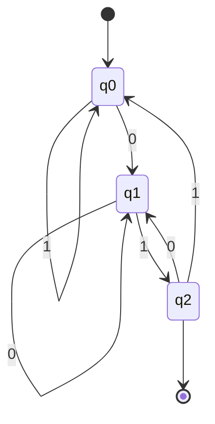

# Theory of Computation

> **Syllabus:** Regular expressions and finite automata; Context-free grammars and push-down automata; Regular and context-free languages, pumping lemma; Turing machines and decidability.
> Revision sheet — focus on the language hierarchy and GATE traps.

---

## 🎬 Start Here: The Big Picture (a story)

Imagine you're a **security guard** at a building with different levels of access control. Each level has a *different kind of machine* watching who comes in:

- **Level 1 — The Turnstile (DFA):** A simple gate. It only remembers *one thing* — whether you've paid. It has no memory of your history. It can check simple patterns like "did the last two people scan their badges?"
- **Level 2 — The Stack of Plates (PDA):** A machine with a **stack** (a pile of plates). It can remember *how many* of something it has seen by pushing/popping plates. It can check "did you open as many doors as you closed?"
- **Level 3 — The Infinite Notebook (Turing Machine):** A machine with an **unlimited notebook** it can read and write. It can compute *anything* a computer can. But some questions about it are **impossible to answer** — like "will this program ever stop?"

**The key insight:** Each machine is *more powerful* than the last. And the languages each can recognize form a **hierarchy**:

$$\text{Regular} \subset \text{Context-Free} \subset \text{Context-Sensitive} \subset \text{Recursively Enumerable}$$

> 🧠 **Why this matters for GATE:** Most questions ask "which machine can recognize this language?" or "is this problem decidable?" — both answered by knowing *where the language sits in this hierarchy*.

---

## TL;DR / Key Concepts

- **Chomsky hierarchy**: Regular ⊂ Context-Free ⊂ Context-Sensitive ⊂ Recursively Enumerable.
- **Finite automata**: DFA, NFA, regular expressions, closure properties.
- **Context-free grammars**: CFG, PDA, ambiguity, normal forms.
- **Pumping lemma**: prove a language is NOT regular / NOT context-free.
- **Turing machines**: decidability, halting problem, undecidability.

---

## 1. Finite Automata — "The Turnstile"

### The Story: A Vending Machine

Think of a **vending machine**. It has a few states:
- **Idle** (waiting for money)
- **Has 1 coin**
- **Has 2 coins** (dispenses)

It reads coins one at a time and changes state. It has **no memory** of coins it saw long ago — only its *current state*. That's a **DFA**.

### What is a DFA?

A **Deterministic Finite Automaton (DFA)** is a machine that:
- Reads input **one symbol at a time** (left to right).
- Has a **finite set of states**.
- For each state + symbol, there's **exactly one** next state (deterministic).
- **Accepts** the string if it ends in an accepting state.

### Worked Example: "Does this string end in 01?"

**The machine** (3 states):



- $q_0$ = "haven't seen anything useful yet"
- $q_1$ = "just saw a 0" (last char was 0)
- $q_2$ = "just saw 01" (accepting)

**Trace the string `101`:**

| Step | Read | Current state | What it means | Next state |
|------|------|---------------|---------------|------------|
| 1 | 1 | $q_0$ | starting | $q_0$ (1 doesn't start "01") |
| 2 | 0 | $q_0$ | saw a 0 | $q_1$ |
| 3 | 1 | $q_1$ | saw "01"! | $q_2$ ✅ accept |

**Trace `100`:**

| Step | Read | Current state | Next state |
|------|------|---------------|------------|
| 1 | 1 | $q_0$ | $q_0$ |
| 2 | 0 | $q_0$ | $q_1$ |
| 3 | 0 | $q_1$ | $q_1$ (still just "saw a 0") |

Ends in $q_1$ (not accepting) → **rejected**. `100` does NOT end in "01". ✅

> 💡 **The intuition:** The DFA "remembers" only the *last relevant thing* it saw. It can't count, can't remember long histories — just its current state.

### NFA — "The Choose-Your-Own-Adventure Machine"

An **NFA** is like a DFA but it can be in **multiple states at once** (or "guess" the right path). It accepts if *any* path leads to an accepting state.

**Key fact:** NFAs and DFAs recognize the **same** languages. Any NFA can be converted to a DFA (subset construction).

### Regular Expressions — "The Pattern Language"

A **regular expression** is a compact way to describe a regular language:

| Symbol | Meaning | Example |
|--------|---------|---------|
| `a` | literal | `a` matches "a" |
| `a\|b` | **or** | `a\|b` matches "a" or "b" |
| `ab` | **concatenation** | `ab` matches "ab" |
| `a*` | **zero or more** | `a*` matches "", "a", "aa", ... |
| `a+` | one or more | `a+` matches "a", "aa", ... |

**Example:** `(0|1)*01` = "any string of 0s and 1s ending in 01" — exactly our DFA above!

> 💡 **GATE trap:** Regular languages are **closed** under union, intersection, complement, concatenation, and Kleene star. But $\{a^n b^n\}$ is **NOT** regular — it needs to *count*, and a DFA can't count.

---

## 2. Context-Free Grammars — "The Stack of Plates"

### The Story: Matching Parentheses

A DFA can't check if parentheses are balanced: `((()))` is balanced, `(()` is not. Why? Because checking balance requires **counting** how many `(` you've seen — and a DFA has no memory.

But a **PDA** (Pushdown Automaton) has a **stack**:
- See `(` → **push** a plate.
- See `)` → **pop** a plate.
- At the end, if the stack is empty → balanced! ✅

### What is a CFG?

A **Context-Free Grammar** is a set of **rewrite rules** that generate strings. It's like a recipe:

```
S → aSb    (add an 'a' on the left and 'b' on the right)
S → ε      (or stop)
```

**Let's "cook" the string `aabb`:**

| Step | Current string | Rule used |
|------|----------------|-----------|
| Start | S | — |
| 1 | aSb | S → aSb |
| 2 | aaSbb | S → aSb |
| 3 | aabb | S → ε |

This grammar generates exactly $\{a^n b^n\}$ — the language a DFA **cannot** recognize, but a PDA **can**.

### Ambiguity — "Two Ways to Parse"

A grammar is **ambiguous** if a string has **two different parse trees**.

**Example:** $S \to SS \mid a$. The string `aaa` can be parsed as:
- $(aa)a$ (group left)
- $a(aa)$ (group right)

Two different trees → **ambiguous**.

> 💡 **GATE trap:** $\{a^n b^n c^n\}$ is **NOT** context-free. A single stack can count *one* thing (a's vs b's), but counting *two* things (a's, b's, AND c's) needs more power.

---

## 3. Pumping Lemma — "The Repetition Trick"

### The Story: Why Can't a DFA Count?

A DFA has a **fixed number of states** (say $p$ of them). If you feed it a string longer than $p$, it must **revisit some state** — it "loops". That loop can be **repeated** any number of times.

**The Pumping Lemma** formalizes this: for any regular language, there's a number $p$ such that any long-enough string can be split into $xyz$ where the middle part $y$ can be **"pumped"** (repeated) any number of times, and the result is still in the language.

### How to Use It (to prove a language is NOT regular)

**Goal:** Show $\{a^n b^n\}$ is not regular.

**Step 1 — Assume** it IS regular. Then it has a pumping length $p$.

**Step 2 — Pick** a long string: $w = a^p b^p$ (p a's, then p b's).

**Step 3 — The pumping lemma says** $w = xyz$ with $|xy| \le p$ and $|y| \ge 1$. Since $|xy| \le p$, both $x$ and $y$ are **only a's** (they're in the first $p$ characters).

**Step 4 — Pump** $y$: $xy^2z = a^{p+k} b^p$ (more a's than b's). This is **NOT** of the form $a^n b^n$ → **contradiction!**

**Conclusion:** $\{a^n b^n\}$ is **not regular**. ✅

> 💡 **The trick:** Pick a string where pumping *breaks* the pattern. For $\{a^n b^n\}$, pumping the a's makes the counts unequal.

---

## 4. Turing Machines & Decidability — "The Infinite Notebook"

### The Story: The Universal Computer

A **Turing Machine** is the most powerful machine — it has an **infinite tape** it can read AND write, and can move left/right. It can compute **anything** a real computer can.

### Decidable vs Undecidable — "Can We Always Answer?"

Some questions about programs are **impossible to answer** in general:

| Problem | Decidable? | Intuition |
|---------|-----------|-----------|
| Does this DFA accept string $w$? | ✅ Yes | Just run it |
| Is this DFA's language empty? | ✅ Yes | Check reachable accepting states |
| Does this CFG generate string $w$? | ✅ Yes | Try all derivations |
| Are two CFGs equivalent? | ❌ No | Too hard |
| **Does this program halt?** (Halting problem) | ❌ **No** | The famous one |

### The Halting Problem — "The Barber Paradox"

**The question:** Given a program and its input, will the program ever stop?

**Why it's undecidable:** Imagine a program $H$ that could answer this. Now build a program $D$ that:
1. Asks $H$ "does $D$ halt?"
2. If $H$ says "yes, it halts" → $D$ **loops forever**.
3. If $H$ says "no, it doesn't halt" → $D$ **halts**.

Either way, $D$ does the *opposite* of what $H$ predicted → **contradiction**. So no such $H$ can exist.

> 💡 **GATE trap:** The halting problem is **undecidable** — no algorithm can solve it for all inputs. But *specific* programs can be checked; it's the *general* problem that's impossible.

---

## 🎯 GATE PYQs

**Q1 (GATE 2021, 1 mark):** The language $\{a^n b^n \mid n \ge 0\}$ is:
- **Answer:** context-free but not regular. *(It needs a stack to count.)*

**Q2 (GATE 2020, 2 marks):** Which of the following is undecidable?
- (A) Membership in regular language (B) Halting problem (C) Membership in CFL (D) DFA emptiness
- **Answer: (B)** Halting problem. *(The others are all decidable — you can just run the machine.)*

**Q3 (GATE 2019, 1 mark):** Regular languages are closed under:
- **Answer:** union, intersection, complement (all three).

**Q4 (GATE 2018, 2 marks):** The language $\{a^n b^n c^n\}$ is:
- **Answer:** context-sensitive but not context-free. *(One stack can't count two things.)*

**Q5 (GATE 2017, 1 mark):** A PDA can recognize:
- **Answer:** context-free languages. *(PDA = DFA + stack.)*

---

## 📚 Deep Dive

- [Theory of Computation — Deep Dive](../_deep_dives/toc_deep.md) — NFA→DFA conversion, CFG normal forms, TM variants, more PYQs.

---

## 🔗 Prerequisites / Cross-References

- Requires [Discrete Math — Logic, Sets](../01_Engineering_Math/discrete_math.md).
- Foundation for [Compiler Design — parsing](../07_Compiler_Design/compiler_design.md).
- Regular expressions used in [Compiler Design — lexical analysis](../07_Compiler_Design/compiler_design.md).