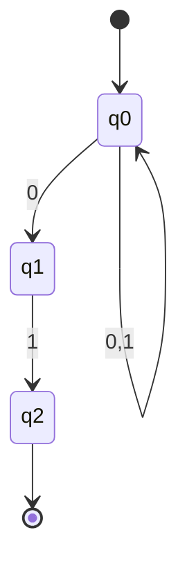

# Theory of Computation — Deep Dive

> In-depth reference for [Theory of Computation](../06_Theory_of_Computation/toc.md). NFA→DFA conversion, CFG normal forms, TM variants, and extended PYQs.

---

## 1. Finite Automata

### DFA vs NFA
- DFA: one transition per symbol per state.
- NFA: multiple transitions, ε-transitions.
- NFA and DFA recognize the same languages (regular).

### NFA → DFA Conversion
- Subset construction: each DFA state is a set of NFA states.
- ε-closure: all states reachable via ε.

### Regular Expressions
- Union `|`, concatenation, Kleene star `*`.
- Every regular expression ↔ DFA/NFA.

#### 1.1 Worked Example — DFA State Transition Table

**Given:** DFA for strings over {0,1} ending in "01". States: $q_0$ (start), $q_1$, $q_2$ (accept).

**Transition table:**

| State | on 0 | on 1 | Accepting? |
|-------|------|------|------------|
| $q_0$ | $q_1$ | $q_0$ | No |
| $q_1$ | $q_1$ | $q_2$ | No |
| $q_2$ | $q_1$ | $q_0$ | **Yes** |

**Trace input `101`:**

| Step | Input | Current state | Next state |
|------|-------|---------------|------------|
| 1 | 1 | $q_0$ | $q_0$ |
| 2 | 0 | $q_0$ | $q_1$ |
| 3 | 1 | $q_1$ | $q_2$ (accept) |

**Result:** `101` ends in "01" → **accepted**.

> 💡 **Transition table** is the tabular form of a DFA. Each row = state, each column = input symbol, cell = next state. Mark accepting states clearly.

#### 1.2 Worked Example — NFA → DFA Conversion (Subset Construction)

**The story:** An NFA can "guess" — it can be in multiple states at once. To convert it to a DFA, we make each DFA state represent a **set** of NFA states the machine could be in simultaneously.

**Given NFA** for strings ending in "01":

**Step 1 — Start with the NFA start state:** $\{q_0\}$.

**Step 2 — Build the DFA transition table** (each DFA state = a set of NFA states):

| DFA state | on 0 | on 1 |
|-----------|------|------|
| $\{q_0\}$ | $\{q_0, q_1\}$ | $\{q_0\}$ |
| $\{q_0, q_1\}$ | $\{q_0, q_1\}$ | $\{q_0, q_2\}$ |
| $\{q_0, q_2\}$ | $\{q_0, q_1\}$ | $\{q_0\}$ |

**Step 3 — Accepting states:** any DFA state containing $q_2$ → $\{q_0, q_2\}$ is accepting.

> 💡 **The intuition:** The DFA state $\{q_0, q_1\}$ means "the NFA could be in $q_0$ OR $q_1$ right now." We track all possibilities at once. This is why NFA and DFA recognize the same languages — the DFA just simulates all NFA paths simultaneously.

---

## 2. Context-Free Grammars

### CFG Components
- $G = (V, \Sigma, P, S)$: variables, terminals, productions, start symbol.

### Ambiguity
- A grammar is ambiguous if a string has two parse trees.
- $S \to SS \mid a$ is ambiguous.

### Normal Forms
- **CNF** (Chomsky): $A \to BC$ or $A \to a$.
- **GNF** (Greibach): $A \to a\alpha$.

### PDA
- Pushdown automaton = NFA + stack.
- Recognizes context-free languages.

#### 2.1 Worked Example — CFG Derivation (The Recipe)

**The story:** A CFG is a recipe. You start with the "start ingredient" $S$ and keep applying rules until you have only "finished ingredients" (terminals).

**Given grammar:** $S \to aSb \mid \epsilon$

**Derive `aabb` step by step:**

| Step | Current string | Rule applied | What it means |
|------|----------------|--------------|---------------|
| 0 | S | — | start |
| 1 | aSb | $S \to aSb$ | wrap with a...b |
| 2 | aaSbb | $S \to aSb$ | wrap again |
| 3 | aabb | $S \to \epsilon$ | remove S |

**Result:** `aabb` ∈ $L(G)$. This grammar generates exactly $\{a^n b^n\}$.

#### 2.2 Worked Example — PDA for Balanced Parentheses (The Stack Story)

**The story:** A PDA is a DFA with a **stack** — like a waiter carrying a stack of plates. It can push and pop.

**Language:** $\{a^n b^n\}$ (balanced a's and b's).

**How the PDA works:**

| Read | Action | Stack |
|------|--------|-------|
| a | **push** a | [a] |
| a | **push** a | [a, a] |
| b | **pop** a | [a] |
| b | **pop** a | [] |

At the end, stack is empty → **accept**! ✅

> 💡 **The intuition:** The stack is the "memory" that lets a PDA count. A DFA can't do this because it has no stack — it can only remember its current state. This is exactly why $\{a^n b^n\}$ is context-free but not regular.

---

## 3. Pumping Lemma

### Regular Pumping Lemma
- For regular $L$, $\exists p$: any $w \in L$, $|w| \ge p$ → $w = xyz$, $|xy| \le p$, $|y| \ge 1$, $xy^k z \in L$.

### CFL Pumping Lemma
- For CFL $L$, $\exists p$: any $w \in L$, $|w| \ge p$ → $w = uvxyz$, $|vxy| \le p$, $|vy| \ge 1$, $uv^k xy^k z \in L$.

#### 3.1 Worked Example — Prove $\{a^n b^n\}$ is NOT Regular

**The story:** A DFA has a fixed number of states. Feed it a long string and it must revisit a state — creating a "loop" that can be repeated. The pumping lemma exploits this loop.

**Step 1 — Assume** $\{a^n b^n\}$ is regular. Then it has a pumping length $p$.

**Step 2 — Choose** $w = a^p b^p$ (p a's followed by p b's). Clearly $|w| = 2p \ge p$.

**Step 3 — The lemma says** $w = xyz$ with $|xy| \le p$ and $|y| \ge 1$. Since $|xy| \le p$, both $x$ and $y$ consist **only of a's** (they're within the first $p$ characters).

**Step 4 — Pump** $y$ once: $xy^2z$. This adds extra a's → $a^{p+k} b^p$ where $k \ge 1$.

**Step 5 — Contradiction:** $a^{p+k}b^p$ has more a's than b's, so it's NOT of the form $a^n b^n$. But the lemma says $xy^2z$ must be in the language. **Contradiction!**

**Conclusion:** $\{a^n b^n\}$ is **not regular**. ✅

> 💡 **The trick:** Choose a string where the "loop" (the $y$ part) is forced to sit entirely in one symbol type, so pumping it breaks the balance. For $\{a^n b^n\}$, the loop is forced into the a's.

---

## 4. Turing Machines & Decidability

### TM Components
- Infinite tape, read/write head, finite control.
- Accepts recursively enumerable languages.

### Decidable vs Undecidable
- **Decidable**: halts on all inputs (recursive).
- **Semi-decidable**: halts on accept, may loop on reject (RE).
- **Undecidable**: no TM decides it.

### Halting Problem
- $HALT = \{\langle M, w \rangle \mid M \text{ halts on } w\}$ is **undecidable**.
- Proof by diagonalization/contradiction.

#### 4.1 The Halting Problem — A Story

**The story (the "liar" program):** Suppose a perfect program $H$ exists that can always tell whether any program halts. We'll build a program $D$ that *breaks* $H$:

1. $D$ asks $H$: "Does $D$ halt on its own input?"
2. If $H$ says **"yes, it halts"** → $D$ deliberately **loops forever**.
3. If $H$ says **"no, it doesn't halt"** → $D$ **halts immediately**.

So whatever $H$ predicts, $D$ does the **opposite**. This is a contradiction — $H$ can't be correct. Therefore **no such $H$ exists**, and the halting problem is **undecidable**.

> 💡 **The intuition:** It's like the barber who shaves everyone who doesn't shave themselves — who shaves the barber? A self-referential contradiction. The halting problem is undecidable because of this same self-reference.

#### 4.2 Language Hierarchy & Decidability Table

| Language class | Machine | Closed under | Example | Decidable? |
|----------------|---------|--------------|---------|------------|
| Regular | DFA/NFA | ∪, ∩, complement, concat, * | $\{a^n\}$ | Yes |
| Context-Free | PDA | ∪, concat, * (not ∩, complement) | $\{a^n b^n\}$ | Yes |
| Context-Sensitive | LBA | ∪, ∩, complement | $\{a^n b^n c^n\}$ | Yes |
| Recursively Enumerable | TM | ∪, ∩, concat, * | Halting problem | No (undecidable) |

> 💡 **Key GATE trap:** Regular and CFL membership are decidable, but many properties (CFG equivalence, TM halting) are undecidable. Memorize which operations each class is closed under.

---

## 5. Extended PYQs

**Q6 (GATE 2016, 2 marks):** The language $\{0^n 1^n 2^n\}$ is:
- **Answer:** context-sensitive, not context-free.

**Q7 (GATE 2015, 2 marks):** Which is undecidable?
- **Answer:** Equivalence of two CFGs.

**Q8 (GATE 2014, 1 mark):** A PDA with two stacks is equivalent to:
- **Answer:** a Turing machine.

---

## 6. References

- Hopcroft, Ullman, Motwani — *Introduction to Automata Theory*
- NPTEL: Theory of Computation (IIT)
- Previous GATE papers