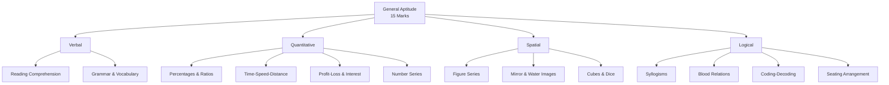

# General Aptitude (15 Marks)

> **Sections:** Verbal, Quantitative, Spatial, and Logical Reasoning.
> This is a **revision** sheet — you've done this before, so focus on speed and common GATE traps.

> **Note:** The aptitude syllabus is identical for GATE CS and GATE DA. The full treatment (formulas, worked examples, PYQs) lives in the [GATE_CS General Aptitude](../../GATE_CS/00_General_Aptitude/aptitude.md) notes. This sheet is a condensed DA-specific refresher.

---

## TL;DR / Key Concepts

- **Verbal**: Reading comprehension, grammar, vocabulary, sentence completion, synonyms/antonyms, idioms.
- **Quantitative**: Arithmetic, algebra, percentages, ratios, time-speed-distance, profit-loss, simple/compound interest, number systems, series.
- **Spatial**: Visual reasoning, figure series, mirror/water images, paper folding, cubes & dice, embedded figures.
- **Logical**: Syllogisms, blood relations, coding-decoding, direction sense, seating arrangement, puzzles, data sufficiency.

### Section Overview
| Section | Focus | Common GATE Traps |
|---------|-------|-------------------|
| **Verbal** | Language & comprehension | Spelling variants, idiom meaning |
| **Quantitative** | Arithmetic & algebra | % increase then decrease ≠ 0 |
| **Spatial** | Visual reasoning | Mirror vs water image confusion |
| **Logical** | Deductive reasoning | "Some" vs "All" in syllogisms |

---

## 🎭 Story / Intuition

**The salary-raise story (percentage trap).** Your salary is ₹100. Your boss gives you a **20% raise** (now ₹120), then later a **20% cut** (20% of 120 = ₹24, so you're at ₹96). You're now *worse off* than before the raise! The trap: a 20% increase followed by a 20% decrease does **not** cancel out — because the decrease is computed on the *larger* amount. This is the single most common aptitude trap. The quick check: $1.2 \times 0.8 = 0.96$ → net **4% loss**.

**The train-crossing story (time-speed-distance).** A train 150 m long crosses a pole. To cross a *pole* (a point), the train only needs to travel its **own length** (150 m). But to cross a *platform* of 200 m, it must travel **length + platform** (350 m). The classic trap is forgetting to add the train's own length. If the train crosses the pole in 15 s, its speed is $\frac{150}{15} = 10$ m/s — then crossing the 200 m platform takes $\frac{350}{10} = 35$ s.

**The syllogism story (logical reasoning).** "All cats are animals. Some animals are pets. Are some cats pets?" Many people answer "yes" — but it's **not guaranteed**. The "some animals that are pets" might be dogs, not cats. In syllogisms, you can only conclude what *must* follow, not what *might* be true. This is the core skill: distinguishing **necessary** conclusions from **possible** ones.

---

## 📐 Key Formulas (Quantitative)

### Percentages
$$\text{Percentage change} = \frac{\text{New} - \text{Old}}{\text{Old}} \times 100$$

### Profit & Loss
$$\text{Profit\%} = \frac{\text{SP} - \text{CP}}{\text{CP}} \times 100, \qquad \text{Loss\%} = \frac{\text{CP} - \text{SP}}{\text{CP}} \times 100$$

### Simple & Compound Interest
$$SI = \frac{P \times R \times T}{100}, \qquad CI = P\left(1 + \frac{R}{100}\right)^T - P$$

### Speed, Distance, Time
$$\text{Speed} = \frac{\text{Distance}}{\text{Time}}, \qquad \text{Average speed} = \frac{\text{Total distance}}{\text{Total time}}$$

### Ratio & Proportion
$$\frac{a}{b} = \frac{c}{d} \implies ad = bc$$

### Number Series / Sequences
- Arithmetic Progression: $a_n = a + (n-1)d$, $\;S_n = \frac{n}{2}(2a + (n-1)d)$
- Geometric Progression: $a_n = ar^{n-1}$, $\;S_n = \frac{a(r^n - 1)}{r - 1}$

---

## ✍️ Worked Examples

**Example 1 (Percentage):** A number is increased by 20% and then decreased by 20%. Net change?
- $1.2 \times 0.8 = 0.96$ → net **4% decrease**. (Never cancels out!)

**Example 2 (Time-Speed-Distance):** A train 150 m long crosses a pole in 15 s. Speed?
- $\text{Speed} = \frac{150}{15} = 10 \text{ m/s} = 36 \text{ km/h}$.

**Example 3 (Syllogism):** All cats are animals. Some animals are pets. Conclusion: Some cats are pets?
- **Not necessarily true** — the "some animals" that are pets may not include cats. (Watch for this classic trap.)

---

## 🎯 GATE PYQs

**Q1 (GATE DA 2024, 1 mark):** A number is increased by 30% and then decreased by 30%. The net change is:
- (A) 0% (B) 9% increase (C) 9% decrease (D) 30% decrease
- **Answer: (C)** — $1.3 \times 0.7 = 0.91$ → 9% decrease.

**Q2 (GATE DA 2024, 1 mark):** The sum of the first 20 terms of the series $1, 3, 5, 7, \dots$ is:
- **Answer:** $S_{20} = \frac{20}{2}(2(1) + 19(2)) = 10 \times 40 = 400$.

**Q3 (GATE DA 2025, 1 mark):** If the ratio of two numbers is 3:4 and their sum is 84, the larger number is:
- **Answer:** $\frac{4}{7} \times 84 = 48$.

**Q4 (GATE DA 2025, 1 mark):** A man walks 5 km north, then 3 km east, then 5 km south. Distance from start:
- **Answer:** 3 km east → **3 km**.

**Q5 (GATE DA 2026, 1 mark):** The compound interest on ₹1000 at 10% p.a. for 2 years is:
- **Answer:** $1000(1.1)^2 - 1000 = 1210 - 1000 = ₹210$.

---

## 📚 Deep Dive

- [GATE_CS General Aptitude — Deep Dive](../../GATE_CS/00_General_Aptitude/aptitude.md) — full formula set, more worked examples, and extended PYQs.

---

## 🔗 Prerequisites / Cross-References

- Standalone section — no technical prerequisites.
- Quantitative aptitude overlaps with [Probability](../01_Probability_Statistics/probability.md) (counting) and [Statistics](../01_Probability_Statistics/statistics.md) (mean/median/mode).