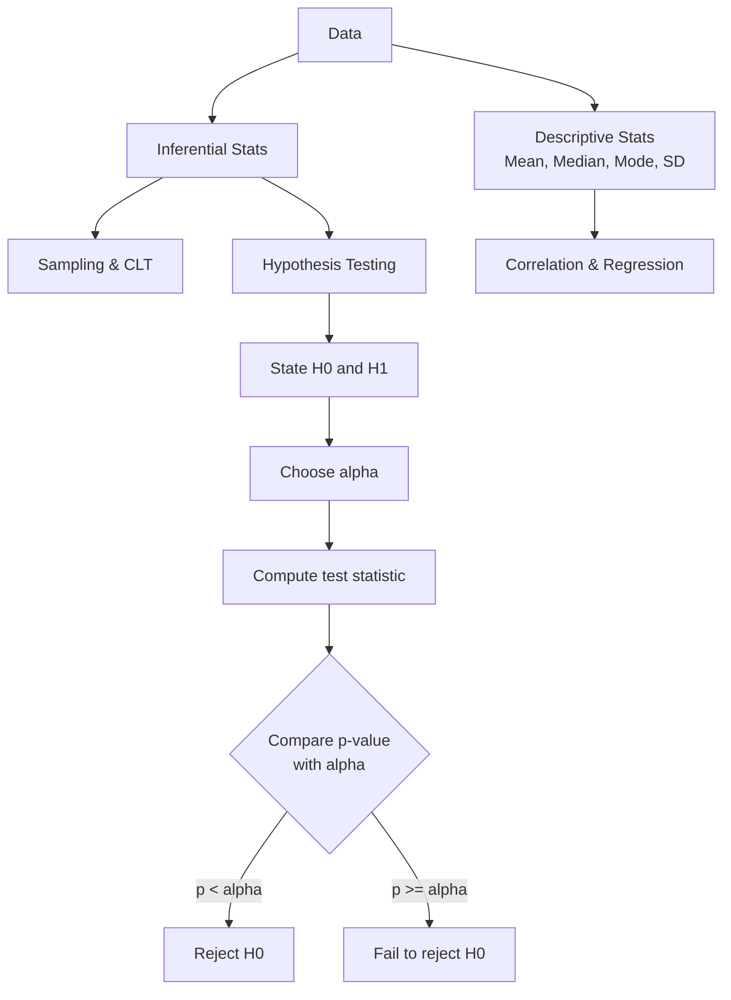

# Statistics

> **Syllabus:** Mean, median, mode, standard deviation. Correlation, covariance, regression. Sampling, central limit theorem, hypothesis testing.
> Revision sheet — focus on formulas and GATE traps.

---

## TL;DR / Key Concepts

- **Descriptive statistics**: Mean, median, mode, variance, standard deviation.
- **Correlation & covariance**: measure of linear association between two variables.
- **Regression**: modeling the relationship between a dependent and independent variable.
- **Sampling & CLT**: sample statistics approximate population parameters; sums/averages become Normal.
- **Hypothesis testing**: null/alternative hypotheses, p-values, Type I/II errors, confidence intervals.

### Measures of Central Tendency & Spread
| Measure | Definition | Robust to Outliers? |
|---------|-----------|---------------------|
| **Mean** | $\bar{x} = \frac{1}{n}\sum x_i$ | ❌ No |
| **Median** | middle value (sorted) | ✅ Yes |
| **Mode** | most frequent value | ✅ Yes |
| **Variance** | $s^2 = \frac{1}{n-1}\sum(x_i-\bar{x})^2$ | ❌ No |
| **Std. Dev** | $s = \sqrt{s^2}$ | ❌ No |

### Correlation Strength
| $\rho$ value | Interpretation |
|--------------|----------------|
| $\rho = 1$ | Perfect positive linear |
| $0 < \rho < 1$ | Positive linear |
| $\rho = 0$ | No linear relation |
| $-1 < \rho < 0$ | Negative linear |
| $\rho = -1$ | Perfect negative linear |

---

## 🎭 Story / Intuition

**The ice cream & drowning "correlation" (correlation ≠ causation).** Every summer, ice cream sales go up **and** drowning incidents go up. If you compute the correlation, you'd get a strong positive $\rho$. Does eating ice cream cause drowning? **No!** Both are caused by a third factor — **hot weather** brings people to beaches (and to ice cream shops). This is the classic trap: correlation measures *association*, not *causation*. In ML, this is why you can't just trust that two correlated features are causally linked.

**The class test story (mean vs median).** A class of 10 students takes a test. Nine score between 70-80, but one student scores 10. The **mean** drops to ~70 because of that one low score (the mean is *sensitive to outliers*). The **median** stays at ~75 (the middle value is *robust*). If you're the teacher reporting results, the median tells a fairer story. This is why real-world data analysis often reports both.

**The hypothesis testing story (innocent until proven guilty).** Hypothesis testing is like a **court trial**. The null hypothesis $H_0$ is "the defendant is innocent." The prosecution (your data) must provide *enough evidence* to convict. You set a threshold — "beyond a reasonable doubt" = your significance level $\alpha = 0.05$. If the evidence (test statistic) is strong enough (p-value < 0.05), you **reject innocence** (reject $H_0$). But there's always a chance of error: convicting an innocent person (Type I error) or letting a guilty person go free (Type II error). You can't eliminate both — you just choose which one you're more afraid of.

**The CLT story (why averages are predictable).** Roll one die — totally unpredictable (1 to 6, all equally likely). But roll **100 dice and average them** — the average is almost always close to 3.5! The more dice you roll, the more the average clusters around the true mean, forming a **bell curve (Normal distribution)**. This is the Central Limit Theorem: no matter what the original distribution looks like, the *average of many samples* becomes Normal. This is why the Normal distribution appears everywhere — it's the natural behavior of averages.

---

## 📐 Key Formulas

### Measures of Central Tendency & Spread
- Mean: $\bar{x} = \frac{1}{n}\sum_{i=1}^n x_i$
- Median: middle value when sorted (odd $n$); avg of two middles (even $n$).
- Mode: most frequent value.
- Variance: $s^2 = \frac{1}{n-1}\sum (x_i - \bar{x})^2$ (sample), $\sigma^2 = \frac{1}{n}\sum (x_i - \mu)^2$ (population)
- Standard deviation: $s = \sqrt{s^2}$

### Covariance & Correlation
- $\text{Cov}(X,Y) = E[XY] - E[X]E[Y] = \frac{1}{n}\sum (x_i - \bar{x})(y_i - \bar{y})$
- Pearson correlation: $\rho = \frac{\text{Cov}(X,Y)}{\sigma_X \sigma_Y}$, $\;-1 \le \rho \le 1$
- $\rho = 1$ perfect positive, $\rho = -1$ perfect negative, $\rho = 0$ no linear relation.

### Simple Linear Regression
- Model: $y = \beta_0 + \beta_1 x + \varepsilon$
- Slope: $\beta_1 = \frac{\text{Cov}(X,Y)}{\text{Var}(X)} = \rho \frac{\sigma_Y}{\sigma_X}$
- Intercept: $\beta_0 = \bar{y} - \beta_1 \bar{x}$
- $R^2 = \rho^2$ (for simple regression) — proportion of variance explained.

### Central Limit Theorem
- For i.i.d. samples with mean $\mu$ and variance $\sigma^2$:
$$\bar{X}_n \approx N\left(\mu, \frac{\sigma^2}{n}\right) \quad \text{for large } n$$

### Hypothesis Testing
- Null $H_0$ vs alternative $H_1$.
- Test statistic (z-test, known $\sigma$): $z = \frac{\bar{x} - \mu_0}{\sigma/\sqrt{n}}$
- **Type I error** ($\alpha$): reject $H_0$ when true. **Type II error** ($\beta$): fail to reject $H_0$ when false.
- **p-value**: probability of observing the result (or more extreme) under $H_0$. Reject $H_0$ if $p < \alpha$.
- Confidence interval for mean: $\bar{x} \pm z_{\alpha/2}\frac{\sigma}{\sqrt{n}}$

#### Type I vs Type II Errors
| Decision | $H_0$ is True | $H_0$ is False |
|----------|---------------|----------------|
| **Reject $H_0$** | ❌ Type I error ($\alpha$) | ✅ Correct |
| **Fail to reject $H_0$** | ✅ Correct | ❌ Type II error ($\beta$) |

---

## ✍️ Worked Examples

**Example 1 (Mean/Median/Mode):** Data: $2, 3, 3, 5, 7$.
- Mean $= \frac{20}{5} = 4$; Median $= 3$; Mode $= 3$.

**Example 2 (Correlation):** If $\text{Cov}(X,Y) = 6$, $\sigma_X = 2$, $\sigma_Y = 3$, then:
- $\rho = \frac{6}{2 \times 3} = 1$ → perfect positive linear relation.

**Example 3 (Regression):** Given $\bar{x}=5$, $\bar{y}=10$, $\text{Cov}=4$, $\text{Var}(X)=2$. Find the regression line.
- $\beta_1 = \frac{4}{2} = 2$; $\beta_0 = 10 - 2(5) = 0$ → $y = 2x$.

**Example 4 (CLT):** Sample mean of $n=100$ from a population with $\mu=50$, $\sigma=10$. Std. error?
- $\frac{\sigma}{\sqrt{n}} = \frac{10}{10} = 1$.

**Example 5 (Hypothesis test):** $H_0: \mu = 100$, sample $\bar{x}=105$, $\sigma=20$, $n=100$, $\alpha=0.05$.
- $z = \frac{105-100}{20/10} = 2.5$. Critical value $z_{0.025}=1.96$. Since $2.5 > 1.96$, **reject $H_0$**.

---

## 🎯 GATE PYQs

**Q1 (GATE DA 2024, 2 marks):** The standard deviation of the data $2, 4, 6, 8, 10$ is:
- **Answer:** Mean $=6$; $\sigma^2 = \frac{(16+4+0+4+16)}{5} = 8$; $\sigma = 2\sqrt{2}$.

**Q2 (GATE DA 2024, 2 marks):** If $\text{Cov}(X,Y) = 0$, then $X$ and $Y$ are:
- (A) always independent (B) linearly uncorrelated (C) negatively correlated (D) none
- **Answer: (B)** — zero covariance means no linear relation, but they may still be dependent.

**Q3 (GATE DA 2025, 2 marks):** In simple linear regression, the coefficient of determination $R^2$ equals:
- **Answer:** the square of the correlation coefficient $\rho^2$.

**Q4 (GATE DA 2025, 2 marks):** By the Central Limit Theorem, the sampling distribution of the sample mean approaches a:
- **Answer:** Normal distribution as sample size increases.

**Q5 (GATE DA 2026, 2 marks):** In hypothesis testing, the probability of rejecting a true null hypothesis is the:
- **Answer:** significance level $\alpha$ (Type I error).

---

## 📚 Deep Dive

- [Statistics — Deep Dive](../_deep_dives/statistics_deep.md) — t-tests, chi-square, ANOVA, more PYQs.

---

## 🔗 Prerequisites / Cross-References

- Requires [Probability](probability.md) (random variables, expectation, variance) and [Calculus](../03_Calculus_Optimization/calculus.md).
- Used in [Supervised Learning](../06_Machine_Learning/supervised_learning.md) (regression), [Model Evaluation](../06_Machine_Learning/model_evaluation.md), and [Unsupervised Learning](../06_Machine_Learning/unsupervised_learning.md) (PCA uses covariance).