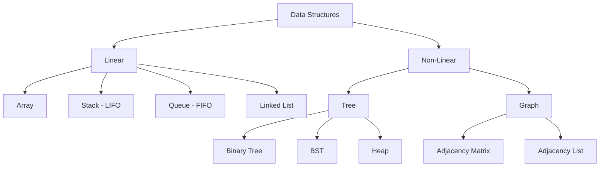

# Data Structures

> **Syllabus:** Stacks, Queues, Linked Lists, Trees, Graphs.
> Revision sheet — focus on operations, complexity, and GATE traps.

> **Note:** Data structures are covered in depth in the [GATE_CS Data Structures](../../GATE_CS/04_Programming_Data_Structures/data_structures.md) notes. This sheet cross-references that content and keeps the DA-relevant essentials (complexities and graph/tree basics needed for ML/AI).

---

## TL;DR / Key Concepts

- **Stacks**: LIFO; push/pop; used in recursion, expression evaluation.
- **Queues**: FIFO; enqueue/dequeue; circular & priority queues.
- **Linked Lists**: singly/doubly; $O(1)$ insert/delete at known node, $O(n)$ access.
- **Trees**: binary trees, BST, heaps; traversal (in/pre/post/level).
- **Graphs**: adjacency matrix/list; BFS/DFS.

### Tree Traversals
| Traversal | Order | Use |
|-----------|-------|-----|
| **In-order** | Left → Root → Right | BST → sorted output |
| **Pre-order** | Root → Left → Right | Copy tree |
| **Post-order** | Left → Right → Root | Delete tree |
| **Level-order** | BFS by level | Shortest path (unweighted) |

### Stack vs Queue
| Feature | Stack | Queue |
|---------|-------|-------|
| Order | LIFO | FIFO |
| Insert | push | enqueue |
| Delete | pop | dequeue |
| Used in | DFS, recursion | BFS |

---

## 🎭 Story / Intuition

**The stack of plates story (LIFO).** A **stack** is like a stack of plates in a cafeteria — you can only take the **top** plate, and you add new plates on **top**. The last plate you put on is the first one you take off (**LIFO** — Last In, First Out). This is exactly how **recursion** works: each function call is pushed onto a stack, and when a function returns, it pops off the top. It's also how your browser's **back button** works — it remembers pages in a stack, so "back" goes to the most recent page first.

**The ticket counter story (FIFO).** A **queue** is like a line at a ticket counter — the **first** person in line gets served **first** (**FIFO** — First In, First Out). New people join at the back, and the front person leaves when served. This is how **BFS** (Breadth-First Search) explores a graph — it processes nodes in the order they were discovered, like a queue of tasks. It's also how a printer handles jobs — first submitted, first printed.

**The tree story (hierarchical data).** A **tree** is like a **family tree** or a **company org chart** — there's a root at the top, and each node branches into children. A **BST** (Binary Search Tree) is a special tree where, at every node, the left child is smaller and the right child is larger. This ordering is what makes searching fast: at each step you eliminate half the tree, giving $O(\log n)$ search — like a **phone book** where you keep halving the search range.

---

## 📐 Key Formulas / Complexities

### Operations
| Structure | Access | Search | Insert | Delete |
|-----------|--------|--------|--------|--------|
| Array | $O(1)$ | $O(n)$ | $O(n)$ | $O(n)$ |
| Stack/Queue | $O(n)$ | $O(n)$ | $O(1)$ | $O(1)$ |
| Linked List | $O(n)$ | $O(n)$ | $O(1)$* | $O(1)$* |
| BST (balanced) | $O(\log n)$ | $O(\log n)$ | $O(\log n)$ | $O(\log n)$ |
| Hash Table | $O(1)$ avg | $O(1)$ avg | $O(1)$ avg | $O(1)$ avg |

\* at a known position.

### Trees
- Height of balanced BST: $O(\log n)$.
- Heap: min/max; insert/delete-min $O(\log n)$; build $O(n)$.

### Graphs
- Adjacency matrix: $O(V^2)$ space; edge check $O(1)$.
- Adjacency list: $O(V + E)$ space; BFS/DFS $O(V + E)$.

---

## ✍️ Worked Examples

**Example 1 (Stack):** Postfix evaluation of `2 3 + 4 *`:
- Push 2, push 3, pop 3,2 → 2+3=5, push 5, push 4, pop 4,5 → 5*4=20. Result **20**.

**Example 2 (Queue):** A queue with `enqueue(1), enqueue(2), dequeue(), enqueue(3), dequeue()` leaves:
- **Answer:** `[3]`.

**Example 3 (BST):** In-order traversal of a BST yields:
- **Answer:** sorted order.

**Example 4 (Graph):** BFS on a graph uses a **queue**; DFS uses a **stack** (or recursion).

---

## 🎯 GATE PYQs

**Q1 (GATE DA 2024, 2 marks):** The data structure used to implement BFS is:
- **Answer:** queue.

**Q2 (GATE DA 2024, 2 marks):** The worst-case time complexity of searching in a balanced BST is:
- **Answer:** $O(\log n)$.

**Q3 (GATE DA 2025, 2 marks):** A stack is a data structure that follows:
- **Answer:** LIFO (Last In, First Out).

**Q4 (GATE DA 2025, 2 marks):** The space complexity of an adjacency matrix for a graph with $V$ vertices is:
- **Answer:** $O(V^2)$.

**Q5 (GATE DA 2026, 2 marks):** In a min-heap, the minimum element is always at:
- **Answer:** the root.

---

## 📚 Deep Dive

- [GATE_CS Data Structures — Deep Dive](../../GATE_CS/_deep_dives/data_structures_deep.md) — advanced trees, heaps, more PYQs.
- [Algorithms](algorithms.md) — search/sort/graph algorithms.

---

## 🔗 Prerequisites / Cross-References

- Requires [Python](python.md) for implementation.
- Used in [Algorithms](algorithms.md), [AI Search](../07_Artificial_Intelligence/ai_search.md) (graphs, BFS/DFS), and [Machine Learning](../06_Machine_Learning/supervised_learning.md) (decision trees, K-NN).