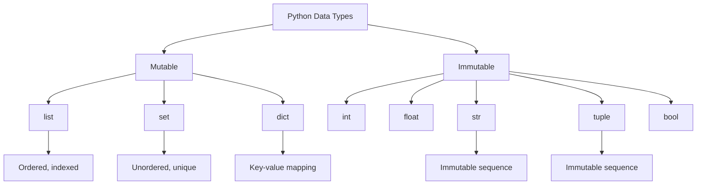

# Python Programming

> **Syllabus:** Programming in Python.
> Revision sheet — focus on syntax, data structures, and GATE traps.

---

## TL;DR / Key Concepts

- **Data types**: int, float, str, bool, None; mutable vs immutable.
- **Built-in collections**: list, tuple, set, dict.
- **Control flow**: if/elif/else, for, while, comprehensions.
- **Functions**: def, lambda, args/kwargs, scope.
- **OOP**: classes, inheritance, dunder methods.
- **Common libraries**: numpy, pandas, matplotlib (relevant to DA).



### Mutable vs Immutable
| Type | Mutable? | Ordered? | Notes |
|------|----------|----------|-------|
| `list` | ✅ | ✅ | indexed, append/pop |
| `tuple` | ❌ | ✅ | immutable sequence |
| `set` | ✅ | ❌ | unique elements |
| `dict` | ✅ | ✅ (3.7+) | key→value mapping |
| `str` | ❌ | ✅ | immutable sequence |

### Common Operations & Complexity
| Operation | Complexity |
|-----------|------------|
| `x in list` | $O(n)$ |
| `x in set` / `x in dict` | $O(1)$ avg |
| `list.append` | $O(1)$ amortized |
| `list.insert(0, x)` | $O(n)$ |
| `dict[key]` | $O(1)$ avg |

---

## 🎭 Story / Intuition

**The shopping list story (list vs dict).** A **list** is like a numbered shopping list — items are in order, and you find something by *counting down the positions* (indexing). To check if "milk" is on the list, you have to scan every item ($O(n)$). A **dict** is like a labeled pantry — each item has a *name tag* (key) pointing straight to its shelf (value). To check if "milk" is there, you just look at the "milk" tag and jump straight to it ($O(1)$). This is why dicts and sets are so fast for lookups — they use a **hash** to go directly to the item instead of scanning.

**The mutable vs immutable story (why it matters).** Think of a **list** as a **whiteboard** — you can erase and rewrite items in place (mutable). A **tuple** is like a **printed receipt** — once printed, you can't change it (immutable). The trap: when you write `b = a` for a list, you're not copying the whiteboard — you're just pointing to the *same* whiteboard. So `b.append(4)` changes `a` too! This "aliasing" bug is a classic GATE trap. To get a real copy, use `a[:]` or `a.copy()`.

**The comprehension story (Pythonic speed).** A **list comprehension** `[x**2 for x in range(5)]` is a compact way to build a list in one line — like saying "give me the square of every number from 0 to 4." It's faster and cleaner than a manual `for` loop with `append`. GATE loves testing whether you can read these one-liners correctly.

---

## 📐 Key Formulas / Cheat Sheet

### Common Operations
- `len(x)`, `x.append(v)` (list), `x.add(v)` (set), `x[key] = val` (dict)
- Slicing: `lst[start:stop:step]`
- List comprehension: `[expr for item in iterable if cond]`
- `range(start, stop, step)`

### Function & Lambda
```python
def add(a, b=0):      # default arg
    return a + b

square = lambda x: x * x   # lambda
```

### OOP
```python
class Animal:
    def __init__(self, name):
        self.name = name
    def speak(self):
        return "..."

class Dog(Animal):          # inheritance
    def speak(self):
        return "Woof"
```

---

## ✍️ Worked Examples

**Example 1 (Comprehension):** `[x**2 for x in range(5) if x % 2 == 0]` → `[0, 4, 16]`.

**Example 2 (Aliasing):** `a = [1,2,3]; b = a; b.append(4)` → `a` is now `[1,2,3,4]` (same object). Use `b = a[:]` or `b = a.copy()` to copy.

**Example 3 (Dict):** `d = {'a': 1, 'b': 2}`; `d.get('c', 0)` → `0` (no KeyError).

**Example 4 (Time complexity):** `x in list` is $O(n)$; `x in set` is $O(1)$ average.

---

## 🎯 GATE PYQs

**Q1 (GATE DA 2024, 2 marks):** The output of `print(len([1, [2, 3], 4]))` is:
- **Answer:** 3 (the inner list counts as one element).

**Q2 (GATE DA 2024, 2 marks):** Which of the following is immutable in Python?
- (A) list (B) dict (C) tuple (D) set
- **Answer: (C)** — tuple.

**Q3 (GATE DA 2025, 2 marks):** The time complexity of checking membership in a Python `set` is:
- **Answer:** $O(1)$ average.

**Q4 (GATE DA 2025, 2 marks):** `list(range(1, 10, 2))` produces:
- **Answer:** `[1, 3, 5, 7, 9]`.

**Q5 (GATE DA 2026, 2 marks):** The output of `print(3 // 2)` in Python is:
- **Answer:** `1` (floor division).

---

## 📚 Deep Dive

- [Python — Deep Dive](../_deep_dives/python_deep.md) — numpy/pandas, generators, decorators, more PYQs.

---

## 🔗 Prerequisites / Cross-References

- Standalone language topic.
- Used in [Data Structures](data_structures.md), [Algorithms](algorithms.md), and all [Machine Learning](../06_Machine_Learning/supervised_learning.md) implementations.