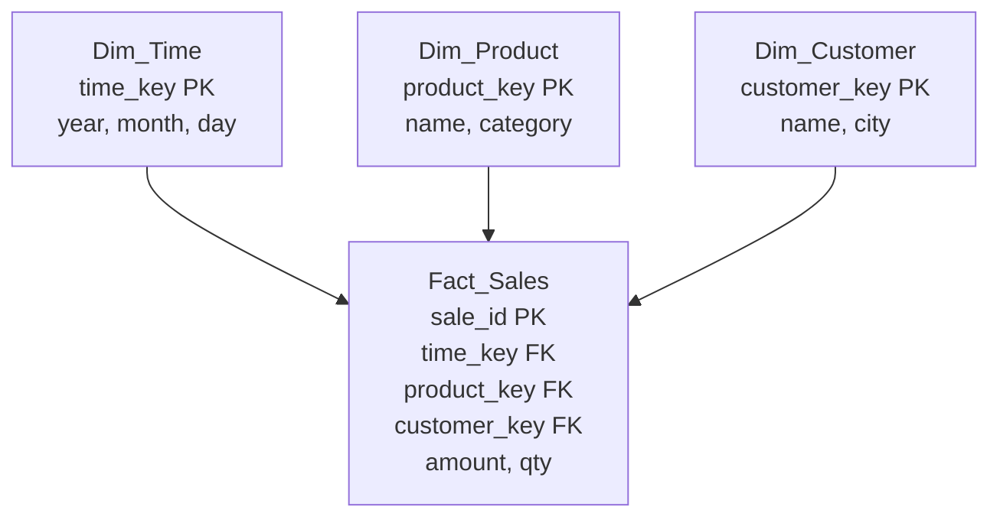
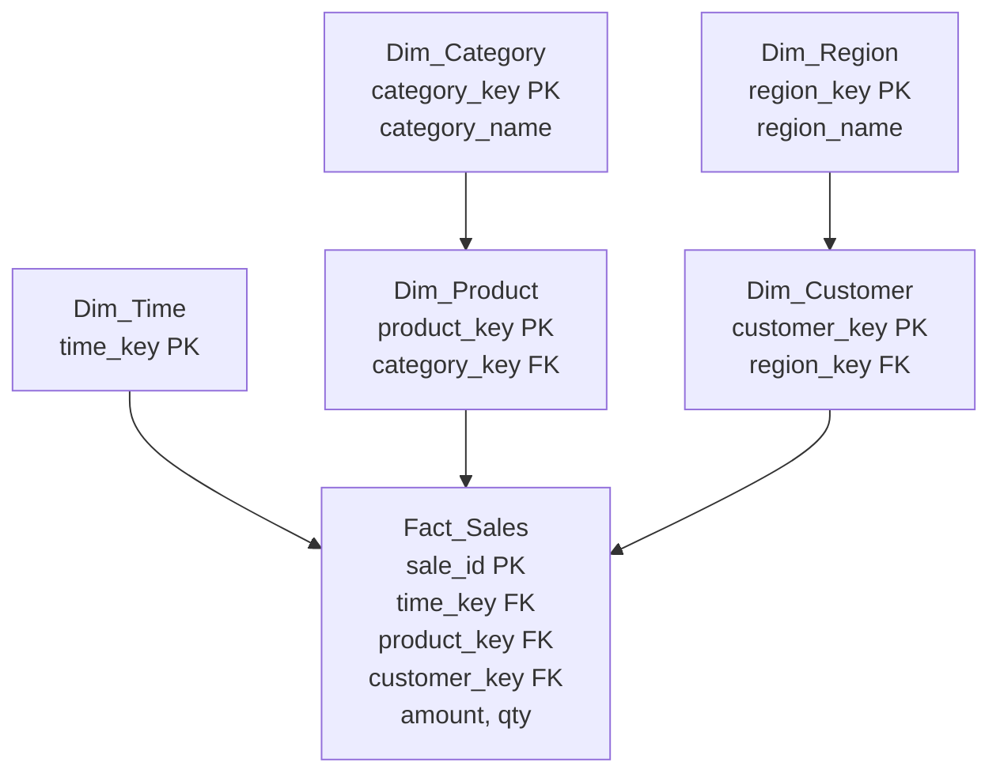

# Data Warehousing

> **Syllabus:** Data warehousing concepts (star schema, snowflake schema).
> Revision sheet — focus on schema design and GATE traps.

---

## TL;DR / Key Concepts

- **Data warehouse**: centralized repository for analytics/reporting (OLAP), distinct from transactional DB (OLTP).
- **Star schema**: one central **fact table** + surrounding **dimension tables** (denormalized).
- **Snowflake schema**: dimensions are **normalized** into sub-dimensions.
- **Fact table**: measures/quantitative data + foreign keys to dimensions.
- **Dimension table**: descriptive attributes (time, product, customer, location).

### Star Schema

### Snowflake Schema

### Star vs Snowflake
| Feature | Star Schema | Snowflake Schema |
|---------|-------------|------------------|
| Dimension tables | Denormalized (single level) | Normalized (hierarchical) |
| Redundancy | Higher | Lower |
| Query performance | Faster (fewer joins) | Slower (more joins) |
| Storage | More | Less |
| Complexity | Simple | More complex |

---

## 🎭 Story / Intuition

**The supermarket analytics story (why warehouses exist).** A supermarket's **transaction database** (OLTP) is optimized for *recording* each sale quickly — thousands of tiny updates per second. But when the manager asks, "What was our total ice cream sales last summer by region?", running that query on the transaction database would be painfully slow (it has to scan millions of individual transactions). So the supermarket builds a **data warehouse** (OLAP) — a separate, pre-aggregated store optimized for *analysis*. This is the core idea: **OLTP for transactions, OLAP for analytics.**

**The star schema story (the hub-and-spoke).** Think of a **star schema** like a **bicycle wheel**: the **fact table** is the hub (center), and the **dimension tables** are the spokes radiating outward. The fact table holds the *numbers* (measures like `amount`, `qty`) plus pointers (foreign keys) to the dimensions. The dimensions hold the *descriptive context* (what, when, who, where). To answer "sales by product by month," you join the fact table to the `Dim_Product` and `Dim_Time` spokes. Because dimensions are **denormalized** (single-level), the joins are few and fast.

**The snowflake schema story (normalizing the spokes).** A **snowflake schema** takes the star and *normalizes* the dimensions. Instead of `Dim_Product` holding `category` directly, it splits into `Dim_Product` → `Dim_Category` → `Dim_Department`. This looks like a snowflake because the spokes now branch. The benefit: **less redundancy** (category names stored once, not repeated per product). The cost: **more joins** to answer a query (you must traverse the branches), making it slower. So it's a tradeoff: **star = fast but redundant; snowflake = compact but slower.**

---

## 📐 Key Formulas / Concepts

### Key Terms
- **Fact table**: contains measures (e.g., sales amount, quantity) and dimension foreign keys.
- **Dimension table**: descriptive context (e.g., `Dim_Time`, `Dim_Product`).
- **Grain**: the level of detail of a fact (e.g., per transaction, per day).
- **OLTP** vs **OLAP**: OLTP = transactions (normalized); OLAP = analytics (denormalized, star/snowflake).

---

## ✍️ Worked Examples

**Example 1 (Star schema):** A sales warehouse has a central `Sales` fact table (with `amount`, `qty`, and FKs to `Dim_Time`, `Dim_Product`, `Dim_Customer`). This is a:
- **Answer:** star schema (dimensions are single-level, denormalized).

**Example 2 (Snowflake):** If `Dim_Product` is split into `Dim_Product` and `Dim_Category`, the schema becomes:
- **Answer:** snowflake schema (normalized dimension).

**Example 3 (Fact vs Dimension):** `sales_amount` is a **measure** (fact); `product_name` is a **dimension attribute**.

---

## 🎯 GATE PYQs

**Q1 (GATE DA 2024, 2 marks):** In a star schema, the central table is called the:
- **Answer:** fact table.

**Q2 (GATE DA 2024, 2 marks):** Compared to a star schema, a snowflake schema has dimensions that are:
- **Answer:** normalized.

**Q3 (GATE DA 2025, 2 marks):** Which schema typically requires more joins for a query?
- (A) Star (B) Snowflake (C) Both equal (D) None
- **Answer: (B)** — snowflake has normalized dimensions → more joins.

**Q4 (GATE DA 2025, 2 marks):** A data warehouse is optimized for:
- **Answer:** analytical/OLAP queries rather than OLTP transactions.

**Q5 (GATE DA 2026, 2 marks):** In a star schema, dimension tables are typically:
- **Answer:** denormalized.

---

## 📚 Deep Dive

- [Data Warehousing — Deep Dive](../_deep_dives/data_warehousing_deep.md) — ETL, OLAP operations, fact/dimension design, more PYQs.

---

## 🔗 Prerequisites / Cross-References

- Requires [Databases](databases.md) (relational model, normalization).
- Used in [Machine Learning](../06_Machine_Learning/supervised_learning.md) (data preparation from warehouses).