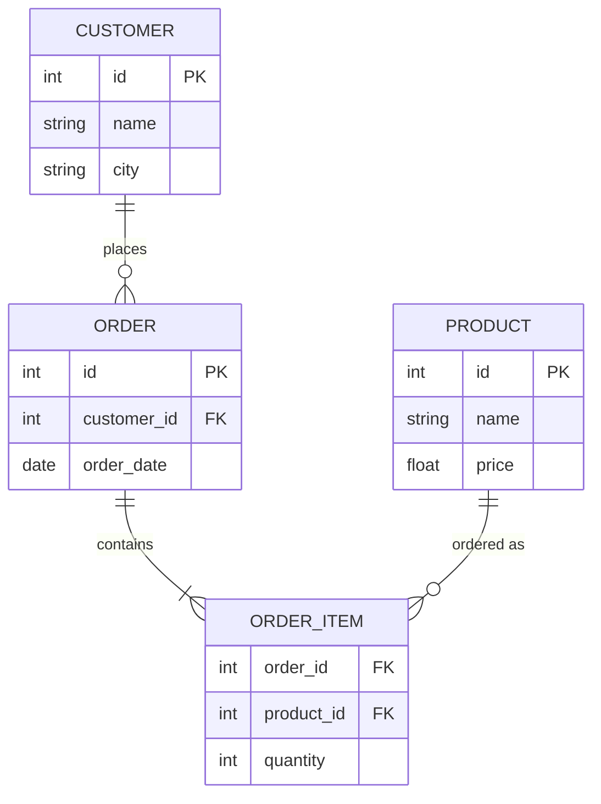

# Databases

> **Syllabus:** ER-modeling, relational model, SQL, normalization.
> Revision sheet — focus on concepts and GATE traps.

> **Note:** Databases are covered in depth in the [GATE_CS Databases](../../GATE_CS/09_Databases/databases.md) notes. This sheet cross-references that content and keeps the DA-relevant essentials (relational model, SQL, normalization).

---

## TL;DR / Key Concepts

- **ER-modeling**: entities, attributes, relationships, keys, cardinality.
- **Relational model**: tables, tuples, attributes, keys (primary, foreign, candidate, super).
- **SQL**: DDL, DML, queries, joins, aggregation.
- **Normalization**: 1NF, 2NF, 3NF, BCNF; functional dependencies.

### Keys Hierarchy
| Key | Definition |
|-----|------------|
| **Super key** | Any set of attributes uniquely identifying a tuple |
| **Candidate key** | Minimal super key |
| **Primary key** | Chosen candidate key |
| **Foreign key** | References a primary key in another table |

### SQL Joins
| Join | Result |
|------|--------|
| **INNER** | Only matching rows in both tables |
| **LEFT** | All left rows + matching right |
| **RIGHT** | All right rows + matching left |
| **FULL OUTER** | All rows from both tables |

### SQL Clause Order

---

## 🎭 Story / Intuition

**The library catalog story (keys & normalization).** Imagine a library. Every book has a unique **ID number** (primary key) — no two books share it. Books reference their author by the author's ID (foreign key) rather than repeating the author's full name everywhere. Why? Because if an author changes their name, you'd only update it in **one place** (the author table) instead of in every book record. This is the whole point of **normalization** — eliminate redundancy so you don't have inconsistent data.

**The messy spreadsheet story (why normalize).** Suppose you keep all data in one giant spreadsheet: `Student(Name, Course, Instructor, Instructor_Phone)`. Problems arise:
- **Redundancy**: the instructor's phone is repeated for every student in that course.
- **Update anomaly**: if the instructor changes their phone, you must update it in *every* row — miss one and you have inconsistent data.
- **Insertion anomaly**: you can't add a new course with no students yet.
- **Deletion anomaly**: deleting the last student in a course deletes the course info too.

**Normalization** fixes this by splitting the spreadsheet into separate tables (relations) so each fact is stored exactly once. 1NF removes repeating groups, 2NF removes partial dependencies, 3NF removes transitive dependencies, BCNF ensures every determinant is a super key. Each level removes a specific kind of redundancy.

**The SQL query story (reading a query).** Reading a SQL query is like following a recipe:
- `FROM` — which table(s) are we cooking with?
- `WHERE` — filter the raw ingredients (rows).
- `GROUP BY` — group similar items (e.g., by department).
- `HAVING` — filter the *groups* (unlike WHERE which filters rows).
- `SELECT` — pick what to show.
- `ORDER BY` — arrange the final result.

The classic trap: `WHERE` filters rows *before* grouping, `HAVING` filters groups *after* grouping.

---

## 📐 Key Formulas / Concepts

### Keys
- **Super key**: any set of attributes that uniquely identifies a tuple.
- **Candidate key**: minimal super key.
- **Primary key**: chosen candidate key.
- **Foreign key**: references a primary key in another table.

### Normal Forms
| NF | Condition |
|----|-----------|
| 1NF | Atomic values (no repeating groups) |
| 2NF | 1NF + no partial dependency on a candidate key |
| 3NF | 2NF + no transitive dependency on a non-key attribute |
| BCNF | For every FD $X \to Y$, $X$ is a super key |

### SQL Basics
- `SELECT ... FROM ... WHERE ... GROUP BY ... HAVING ... ORDER BY`
- Joins: INNER, LEFT, RIGHT, FULL OUTER.
- Aggregates: `COUNT`, `SUM`, `AVG`, `MIN`, `MAX`.

---

## ✍️ Worked Examples

**Example 1 (Keys):** In a relation with attributes $\{A, B, C\}$ and FDs $\{A \to B, B \to C\}$, the candidate key is:
- **Answer:** $A$ (A determines B and C).

**Example 2 (Normalization):** A relation with a transitive dependency $A \to B \to C$ violates:
- **Answer:** 3NF (if B is not a candidate key).

**Example 3 (SQL):** `SELECT COUNT(*) FROM emp WHERE dept = 'IT'` returns:
- **Answer:** number of employees in the IT department.

---

## 🎯 GATE PYQs

**Q1 (GATE DA 2024, 2 marks):** In the relational model, a foreign key is:
- **Answer:** an attribute that references the primary key of another relation.

**Q2 (GATE DA 2024, 2 marks):** A relation is in BCNF if for every functional dependency $X \to Y$:
- **Answer:** $X$ is a super key.

**Q3 (GATE DA 2025, 2 marks):** The SQL clause used to filter groups after aggregation is:
- **Answer:** `HAVING`.

**Q4 (GATE DA 2025, 2 marks):** A relation in 2NF but not 3NF has:
- **Answer:** a transitive dependency.

**Q5 (GATE DA 2026, 2 marks):** The result of an INNER JOIN between two tables contains:
- **Answer:** only rows with matching keys in both tables.

---

## 📚 Deep Dive

- [GATE_CS Databases — Deep Dive](../../GATE_CS/_deep_dives/databases_deep.md) — relational algebra, transactions, indexing, more PYQs.
- [Data Warehousing](data_warehousing.md) — star/snowflake schemas.

---

## 🔗 Prerequisites / Cross-References

- Requires [GATE_CS Discrete Math](../../GATE_CS/01_Engineering_Math/discrete_math.md) (sets, relations).
- Used in [Data Warehousing](data_warehousing.md) and [Machine Learning](../06_Machine_Learning/supervised_learning.md) (data preparation).