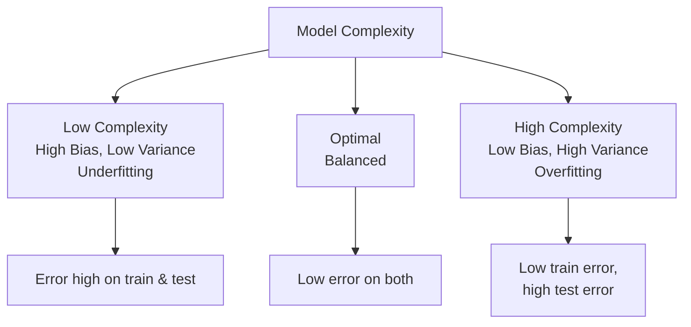
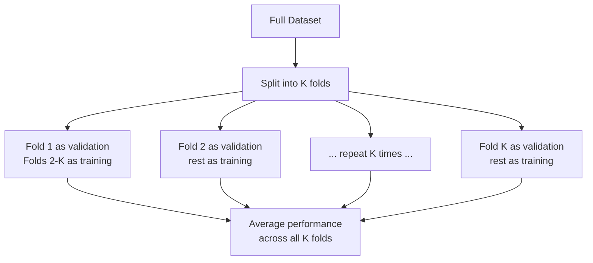

# Model Evaluation

> **Syllabus:** Bias-Variance tradeoff, cross-validation, evaluation metrics.
> Revision sheet — focus on metrics, tradeoffs, and GATE traps.

---

## TL;DR / Key Concepts

- **Bias-Variance tradeoff**: underfitting vs overfitting.
- **Cross-validation**: robust estimate of generalization performance.
- **Evaluation metrics**: accuracy, precision, recall, F1, confusion matrix, ROC/AUC, MSE/MAE.
- **Key ideas**: train/test split, generalization, class imbalance.

### K-Fold Cross-Validation

### Bias-Variance Tradeoff
| Model Complexity | Bias | Variance | Result |
|------------------|------|----------|--------|
| **Too low** | High | Low | Underfitting |
| **Optimal** | Balanced | Balanced | Good generalization |
| **Too high** | Low | High | Overfitting |

### Classification Metrics
| Metric | Formula | Best for |
|--------|---------|----------|
| **Accuracy** | $\frac{TP+TN}{TP+TN+FP+FN}$ | Balanced classes |
| **Precision** | $\frac{TP}{TP+FP}$ | Minimize false positives |
| **Recall** | $\frac{TP}{TP+FN}$ | Minimize false negatives |
| **F1** | $2\frac{P\cdot R}{P+R}$ | Imbalanced classes |

---

## 🎭 Story / Intuition

**The memorizing student story (overfitting / bias-variance).** Imagine a student who **memorizes the textbook word-for-word** but can't answer a single new question. On the exact questions from the book, they score 100% (low training error). But on the exam (new questions), they fail. This is **overfitting** — the model (student) has *high variance*: it fits the training data perfectly but doesn't *generalize*. The opposite is a student who only learns a vague summary and gets the basic idea but misses details — **underfitting** (high bias). The best student learns the *underlying rules* — not memorizing, not too vague — that's the sweet spot between bias and variance.

**The medical test story (precision vs recall).** Imagine a cancer-screening test. **Recall** (sensitivity) asks: "Of all the people who *actually have* cancer, how many did we catch?" You want this **high** — you never want to miss a real case (false negative is dangerous). **Precision** asks: "Of all the people we flagged as having cancer, how many *actually* do?" You want this high too — you don't want to terrify healthy people with false alarms. But there's a **tradeoff**: if you make the test super-sensitive (high recall), you get more false alarms (low precision). The **F1 score** balances both — it's the harmonic mean, punishing you if either is low.

**The "which metric matters?" story (imbalanced data).** Suppose 99% of emails are spam and 1% is real. A lazy model that always predicts "spam" gets **99% accuracy** — sounds great! But it's useless (it deletes all your real mail). This is why **accuracy is misleading for imbalanced data**. Precision, recall, and F1 tell the real story. This is a classic GATE trap: don't be fooled by high accuracy on imbalanced data.

**The "test on new data" story (cross-validation).** If you train and test on the *same* data, the model looks perfect (it memorized the answers). To honestly measure performance, you must test on **data the model has never seen**. **K-fold cross-validation** does this rigorously: split the data into $K$ parts, train on $K-1$, test on the remaining 1, and repeat so every part gets tested once. It's like a student taking $K$ different practice exams — you get a reliable estimate of how they'll do on the real exam.

---

## 📐 Key Formulas

### Bias-Variance Decomposition
$$\text{Expected error} = \text{Bias}^2 + \text{Variance} + \text{Irreducible noise}$$
- **High bias** → underfitting (too simple model).
- **High variance** → overfitting (too complex model).

### Confusion Matrix
| | Predicted Positive | Predicted Negative |
|---|---|---|
| **Actual Positive** | TP | FN |
| **Actual Negative** | FP | TN |

### Classification Metrics
- Accuracy $= \frac{TP + TN}{TP + TN + FP + FN}$
- Precision $= \frac{TP}{TP + FP}$
- Recall (Sensitivity) $= \frac{TP}{TP + FN}$
- $F_1 = 2 \cdot \frac{\text{Precision} \cdot \text{Recall}}{\text{Precision} + \text{Recall}}$
- Specificity $= \frac{TN}{TN + FP}$

### Regression Metrics
- MSE $= \frac{1}{n}\sum (y_i - \hat{y}_i)^2$
- MAE $= \frac{1}{n}\sum |y_i - \hat{y}_i|$
- $R^2 = 1 - \frac{\text{SSE}}{\text{SST}}$

### Cross-Validation
- **K-fold CV**: split data into $K$ folds; train on $K-1$, validate on 1; repeat $K$ times; average.
- **Leave-One-Out (LOOCV)**: $K = n$ (one sample per validation fold).

---

## ✍️ Worked Examples

**Example 1 (Metrics):** Confusion matrix: TP=40, FP=10, FN=20, TN=30.
- Accuracy $= \frac{70}{100} = 0.7$; Precision $= \frac{40}{50} = 0.8$; Recall $= \frac{40}{60} \approx 0.67$; $F_1 = 2\frac{0.8 \times 0.67}{1.47} \approx 0.73$.

**Example 2 (Bias-Variance):** A very deep decision tree that memorizes training data has:
- **Answer:** low bias, high variance (overfitting).

**Example 3 (K-fold):** With 5-fold CV on 100 samples, each validation fold has:
- **Answer:** 20 samples.

---

## 🎯 GATE PYQs

**Q1 (GATE DA 2024, 2 marks):** The F1-score is the harmonic mean of:
- **Answer:** precision and recall.

**Q2 (GATE DA 2024, 2 marks):** A model with high bias and low variance is said to be:
- **Answer:** underfitting.

**Q3 (GATE DA 2025, 2 marks):** In K-fold cross-validation, the data is divided into:
- **Answer:** $K$ equal parts; each part is used once as validation.

**Q4 (GATE DA 2025, 2 marks):** For an imbalanced classification problem, which metric is more informative than accuracy?
- **Answer:** precision, recall, or F1-score.

**Q5 (GATE DA 2026, 2 marks):** Increasing model complexity typically:
- (A) decreases variance (B) increases variance (C) has no effect (D) none
- **Answer: (B)** — more complex models have higher variance.

---

## 📚 Deep Dive

- [Model Evaluation — Deep Dive](../_deep_dives/model_evaluation_deep.md) — ROC/AUC, regularization, learning curves, more PYQs.

---

## 🔗 Prerequisites / Cross-References

- Requires [Supervised Learning](supervised_learning.md) and [Unsupervised Learning](unsupervised_learning.md).
- Uses [Statistics](../01_Probability_Statistics/statistics.md) (hypothesis testing, distributions).