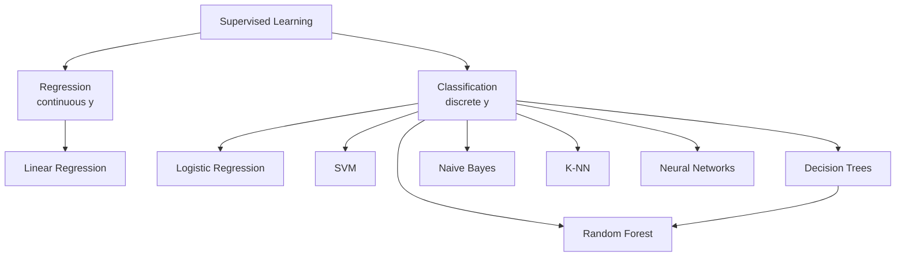
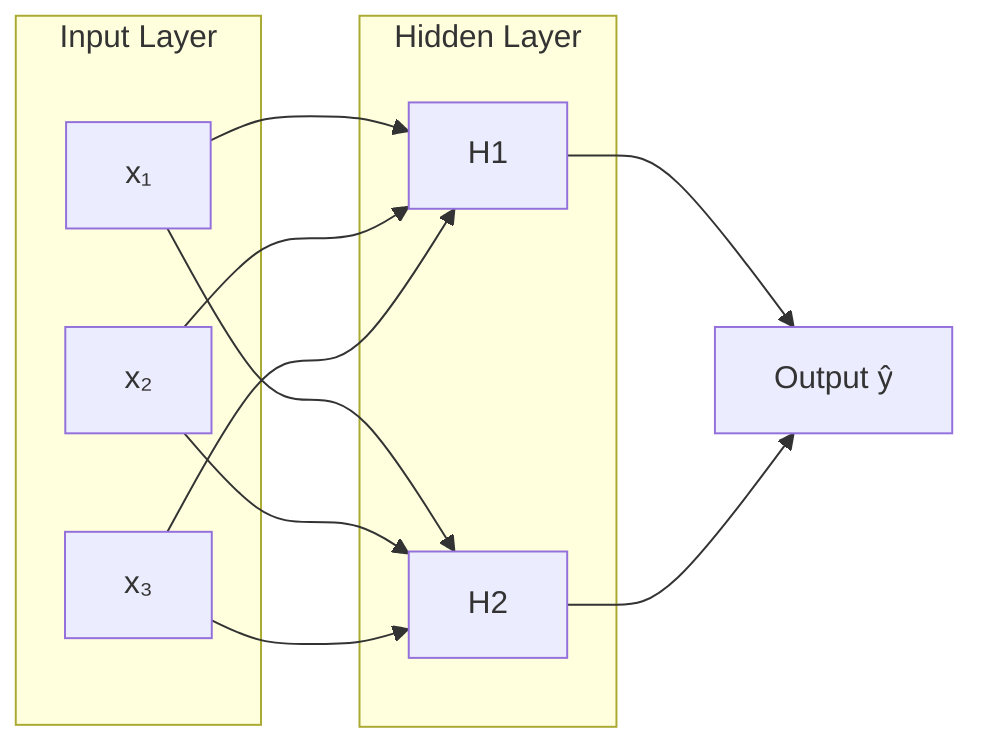

# Supervised Learning

> **Syllabus:** Linear Regression, Logistic Regression, SVM, Decision Trees, Naive Bayes, Random Forests, K-NN, Neural Networks.
> Revision sheet — focus on models, loss functions, and GATE traps.

---

## TL;DR / Key Concepts

- **Supervised learning**: learn a mapping from features $X$ to labels $y$ from labeled data.
- **Regression** (continuous $y$): Linear Regression.
- **Classification** (discrete $y$): Logistic Regression, SVM, Decision Trees, Naive Bayes, Random Forests, K-NN, Neural Networks.
- **Key ideas**: loss functions, gradient descent training, decision boundaries, overfitting.

### Neural Network Architecture

### Algorithm Comparison
| Algorithm | Type | Key Idea | Pros | Cons |
|-----------|------|----------|------|------|
| **Linear Regression** | Regression | Fit line, minimize MSE | Simple, interpretable | Only linear |
| **Logistic Regression** | Classification | Sigmoid + decision boundary | Probabilistic output | Linear boundary |
| **SVM** | Classification | Max-margin hyperplane | Works in high-dim | Kernel tuning |
| **Decision Tree** | Both | Recursive splits (Gini/Entropy) | Interpretable | Overfits |
| **Naive Bayes** | Classification | Bayes + independence | Fast, simple | Independence assumption |
| **Random Forest** | Both | Ensemble of trees | Reduces variance | Less interpretable |
| **K-NN** | Both | Majority vote of neighbors | No training | Slow prediction |
| **Neural Network** | Both | Layers + backprop | Universal approximator | Needs data, compute |

---

## 🎭 Story / Intuition

**The house-price story (linear regression).** You're a real-estate agent who wants to predict house prices from size. You plot past sales: size on the x-axis, price on the y-axis. The points roughly form a line. **Linear regression** draws the "best-fit" line through them — the line that minimizes the total vertical distance (error) to all points. Once you have the line $y = wx + b$, you can predict the price of a new house by plugging in its size. The slope $w$ tells you "how much price increases per extra square foot." This is the foundation of all supervised learning: **learn a function from examples.**

**The spam filter story (classification & Naive Bayes).** Your email provider must decide: is this email **spam** or **not spam**? It looks at features — does it contain "FREE", "WINNER", "click here"? **Naive Bayes** computes: "Given these words appear, what's the probability it's spam?" It uses Bayes' theorem and makes a *naive* assumption — that the words are **independent** of each other (which isn't really true, but works surprisingly well). It's like a jury weighing independent pieces of evidence. Despite the "naive" assumption, it's fast and effective, which is why it powers many spam filters.

**The boundary-drawing story (SVM).** Imagine two groups of points on a board — red and blue. You want to draw a **line** that separates them. But there are *many* possible lines. **SVM** picks the line that's **farthest from both groups** — maximizing the "margin" (the empty gap between the groups). The points closest to the line are the **support vectors** (they "support" the boundary). If the groups aren't linearly separable (can't be split by a straight line), the **kernel trick** lifts the points into a higher dimension where they *can* be separated — like lifting a tangled ball of string so you can see it's actually two separate loops.

**The "guess the animal" story (decision trees).** A **decision tree** is like the game **20 Questions**. "Is it a mammal?" → "Does it fly?" → "Does it swim?" Each question splits the possibilities, and you follow the path to a final answer. The tree *learns* which questions to ask first by choosing the split that best separates the classes (maximizing **information gain** / minimizing **Gini impurity**). A **random forest** is just *many* such trees, each trained on a random subset of data, voting on the answer — like asking a crowd of experts instead of one, which reduces mistakes (variance).

**The "ask your neighbors" story (K-NN).** **K-NN** is the laziest learner — it does *no* training at all. To classify a new point, it just looks at its **$K$ nearest neighbors** and takes a majority vote. If your 3 closest friends all like a movie, you probably will too. It's intuitive and simple, but it's slow at prediction time (must compute distance to every point) and sensitive to feature scaling (a feature measured in kilometers vs meters would dominate the distance).

**The brain-inspired story (neural networks).** A **neural network** mimics a simplified brain. Each **neuron** takes inputs, weights them, sums them, and fires an output through an activation function (like a neuron firing or not). Stack many neurons into **layers**, and the network can learn incredibly complex patterns. It learns by **backpropagation** — when it makes a mistake, it traces the error backward through the network and adjusts each weight to reduce the error (using gradient descent). This is why neural networks can recognize faces, translate languages, and beat humans at Go — they're universal function approximators.

---

## 📐 Key Formulas

### Linear Regression
- Model: $\hat{y} = w^T x + b$
- Loss (MSE): $J(w) = \frac{1}{n}\sum_{i=1}^n (y_i - \hat{y}_i)^2$
- Closed-form (normal equation): $w = (X^TX)^{-1}X^Ty$
- Trained via gradient descent: $w \leftarrow w - \eta \nabla J(w)$

### Logistic Regression (binary classification)
- Sigmoid: $\sigma(z) = \frac{1}{1 + e^{-z}}$, $\;z = w^T x + b$
- Predict $P(y=1|x) = \sigma(z)$; classify as 1 if $\sigma(z) \ge 0.5$.
- Loss (log loss / cross-entropy): $J = -\frac{1}{n}\sum_i \big[y_i \log \hat{p}_i + (1-y_i)\log(1-\hat{p}_i)\big]$

### SVM
- Find hyperplane $w^T x + b = 0$ maximizing margin $\frac{2}{\|w\|}$.
- Hard margin: $\min \frac{1}{2}\|w\|^2$ s.t. $y_i(w^T x_i + b) \ge 1$.
- Soft margin: adds slack variables $\xi_i$ (handles non-separable data).
- Kernel trick: map to higher dimension (RBF, polynomial) for non-linear separation.

### Naive Bayes
- $P(y|x) \propto P(y)\prod_j P(x_j | y)$ (conditional independence assumption).
- Choose class maximizing posterior.

### Decision Trees
- Split on feature minimizing impurity: **Gini** $= 1 - \sum_k p_k^2$ or **Entropy** $= -\sum_k p_k \log_2 p_k$.
- **Information gain** $= \text{Entropy(parent)} - \sum \frac{|child|}{|parent|}\text{Entropy(child)}$.

### Random Forest
- Ensemble of many decision trees (bagging + random feature subset).
- Prediction = majority vote (classification) / average (regression).

### K-NN
- Predict label of a point by majority vote of its $K$ nearest neighbors.
- Distance metric: Euclidean $d = \sqrt{\sum (x_i - x'_i)^2}$.
- Lazy learner (no training); sensitive to feature scaling.

### Neural Networks
- Perceptron: $\hat{y} = \sigma(w^T x + b)$.
- Multi-layer: forward pass through hidden layers with activation functions (ReLU, sigmoid, tanh).
- Trained via **backpropagation** (chain rule) + gradient descent.
- Activation: ReLU $= \max(0, z)$.

---

## ✍️ Worked Examples

**Example 1 (Linear Regression):** Fit $y = wx$ to points $(1,2), (2,4)$. 
- $w = \frac{\sum xy}{\sum x^2} = \frac{2+8}{1+4} = 2$ → $y = 2x$.

**Example 2 (Logistic):** If $\sigma(z) = 0.7$ for a sample, the predicted class is:
- **Answer:** 1 (since $0.7 \ge 0.5$).

**Example 3 (Naive Bayes):** With $P(y=1)=0.5$, $P(x|y=1)=0.8$, $P(x|y=0)=0.2$:
- $P(y=1|x) \propto 0.5 \times 0.8 = 0.4$; $P(y=0|x) \propto 0.5 \times 0.2 = 0.1$ → predict class 1.

**Example 4 (Decision Tree):** A node with 4 positives and 4 negatives has Gini:
- $1 - (0.5^2 + 0.5^2) = 0.5$.

**Example 5 (K-NN):** For $K=3$, if the 3 nearest neighbors have labels $\{1, 1, 0\}$, predict:
- **Answer:** 1 (majority).

---

## 🎯 GATE PYQs

**Q1 (GATE DA 2024, 2 marks):** The loss function used in linear regression is typically:
- **Answer:** Mean Squared Error (MSE).

**Q2 (GATE DA 2024, 2 marks):** The sigmoid function $\sigma(z)$ outputs values in the range:
- **Answer:** $(0, 1)$.

**Q3 (GATE DA 2025, 2 marks):** SVM aims to maximize:
- **Answer:** the margin between the separating hyperplane and the support vectors.

**Q4 (GATE DA 2025, 2 marks):** Naive Bayes assumes that features are:
- **Answer:** conditionally independent given the class.

**Q5 (GATE DA 2026, 2 marks):** K-NN is best described as:
- **Answer:** a lazy, instance-based learning algorithm.

---

## 📚 Deep Dive

- [Supervised Learning — Deep Dive](../_deep_dives/supervised_learning_deep.md) — derivations, kernels, backpropagation, more PYQs.

---

## 🔗 Prerequisites / Cross-References

- Requires [Statistics](../01_Probability_Statistics/statistics.md) (regression), [Linear Algebra](../02_Linear_Algebra/linear_algebra.md), [Optimization](../03_Calculus_Optimization/optimization.md) (gradient descent), [Calculus](../03_Calculus_Optimization/calculus.md), and [Probability](../01_Probability_Statistics/probability.md) (Naive Bayes).
- See [Model Evaluation](model_evaluation.md) for metrics and [Unsupervised Learning](unsupervised_learning.md) for the counterpart.