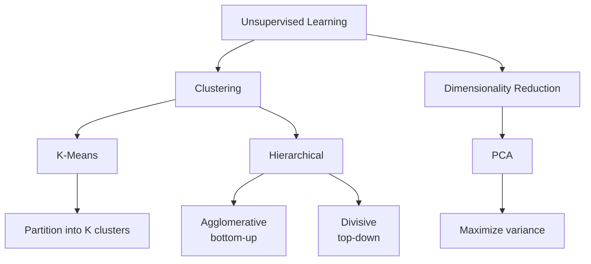
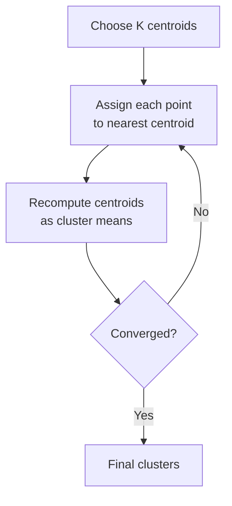
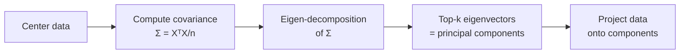

# Unsupervised Learning

> **Syllabus:** K-Means, Hierarchical Clustering, PCA.
> Revision sheet — focus on algorithms, objectives, and GATE traps.

---

## TL;DR / Key Concepts

- **Unsupervised learning**: find structure in unlabeled data.
- **Clustering**: group similar points — K-Means, Hierarchical Clustering.
- **Dimensionality reduction**: PCA (Principal Component Analysis).
- **Key ideas**: distance metrics, cluster centroids, variance maximization.

### K-Means Algorithm Flow

### PCA Flow

### Clustering Comparison
| Feature | K-Means | Hierarchical |
|---------|---------|--------------|
| Approach | Partitional | Agglomerative/Divisive |
| # clusters $K$ | Must specify | From dendrogram |
| Output | Flat clusters | Dendrogram |
| Complexity | Fast | Slower ($O(n^2)$) |
| Deterministic | No (init-dependent) | Yes |

---

## 🎭 Story / Intuition

**The customer segmentation story (K-Means).** A marketing team has data on thousands of customers (age, spending, location) but no labels. They want to group customers into segments for targeted ads. **K-Means** does this: you pick $K$ (say 3) initial "centers," assign each customer to the nearest center, then move each center to the average of its group, and repeat. The customers naturally cluster into groups like "budget shoppers," "luxury buyers," and "occasional buyers." The catch: you must choose $K$ yourself (the **elbow method** helps), and the result depends on where you start the centers (hence **K-Means++** for better initialization).

**The family-tree story (hierarchical clustering).** Instead of choosing $K$ upfront, **hierarchical clustering** builds a **tree (dendrogram)** of groupings. Start with every point as its own cluster, then repeatedly merge the two *closest* clusters. The result is a tree showing the full nesting — like a **family tree** where you can cut at any level to get a different number of families. If you cut high, you get few big clusters; cut low, you get many small ones. This is great when you don't know how many clusters you want — the dendrogram shows you all options at once.

**The photo-compression story (PCA).** Imagine a photo with 1000 features (pixels) per image. Many of these features are **redundant** — neighboring pixels are highly correlated. **PCA** finds the few *directions* (principal components) along which the data varies the most, and projects the data onto them. It's like looking at a 3D object from its most informative angle — you lose some detail but keep the essential shape. This is how **dimensionality reduction** works: compress 1000 features into, say, 10 while keeping most of the *variance* (information). It's also how face-recognition systems compress faces into "eigenfaces."

**The "find the pattern" story (why unsupervised).** The key difference from supervised learning: **no labels**. In supervised learning, you're told the answer and learn the rule. In unsupervised learning, you're just given data and asked to *find structure* — groups (clustering) or the essential directions (PCA). It's like being handed a pile of photos with no captions and asked to organize them — you discover the categories yourself.

---

## 📐 Key Formulas

### K-Means
- Objective: minimize within-cluster sum of squares (WCSS):
$$\min \sum_{k=1}^K \sum_{x \in C_k} \|x - \mu_k\|^2$$
- Steps: (1) choose $K$ centroids, (2) assign each point to nearest centroid, (3) recompute centroids as means, (4) repeat until convergence.
- Sensitive to initialization and choice of $K$ (use elbow method).

### Hierarchical Clustering
- **Agglomerative** (bottom-up): start each point as its own cluster, merge closest pairs.
- **Divisive** (top-down): start with one cluster, split recursively.
- Linkage criteria: single (min distance), complete (max distance), average, Ward's (min variance increase).
- Result visualized as a **dendrogram**.

### PCA (Principal Component Analysis)
- Find directions of maximum variance (principal components).
- Steps: (1) center data, (2) compute covariance matrix $\Sigma = \frac{1}{n}X^TX$, (3) find eigenvectors/eigenvalues, (4) project onto top-$k$ eigenvectors.
- Components are orthogonal; first component captures most variance.
- Related to **SVD**: $X = U\Sigma V^T$; principal components are columns of $V$.
- Variance explained by component $i$: $\frac{\lambda_i}{\sum_j \lambda_j}$.

---

## ✍️ Worked Examples

**Example 1 (K-Means):** Points $\{1, 2, 5, 6\}$, $K=2$, initial centroids 1 and 5.
- Assign: {1,2}→1, {5,6}→5. New centroids: $\frac{1+2}{2}=1.5$, $\frac{5+6}{2}=5.5$. Stable → clusters {1,2} and {5,6}.

**Example 2 (Hierarchical):** Single linkage merges clusters based on:
- **Answer:** the minimum distance between any two points in the clusters.

**Example 3 (PCA):** If the eigenvalues of the covariance matrix are $[10, 2, 1]$, the variance explained by the first component is:
- $\frac{10}{13} \approx 0.77$ (77%).

---

## 🎯 GATE PYQs

**Q1 (GATE DA 2024, 2 marks):** K-Means clustering minimizes:
- **Answer:** the within-cluster sum of squared distances (WCSS).

**Q2 (GATE DA 2024, 2 marks):** The output of hierarchical agglomerative clustering is often visualized as a:
- **Answer:** dendrogram.

**Q3 (GATE DA 2025, 2 marks):** PCA finds directions that maximize:
- **Answer:** variance of the projected data.

**Q4 (GATE DA 2025, 2 marks):** The principal components in PCA are:
- **Answer:** orthogonal to each other.

**Q5 (GATE DA 2026, 2 marks):** Which of the following is an unsupervised learning algorithm?
- (A) Linear Regression (B) K-Means (C) SVM (D) Logistic Regression
- **Answer: (B)** — K-Means.

---

## 📚 Deep Dive

- [Unsupervised Learning — Deep Dive](../_deep_dives/unsupervised_learning_deep.md) — K-Means++ , linkage details, PCA derivation via SVD, more PYQs.

---

## 🔗 Prerequisites / Cross-References

- Requires [Linear Algebra](../02_Linear_Algebra/linear_algebra.md) (eigenvalues, SVD) and [Statistics](../01_Probability_Statistics/statistics.md) (covariance).
- See [Supervised Learning](supervised_learning.md) for the labeled-data counterpart and [Model Evaluation](model_evaluation.md) for metrics.