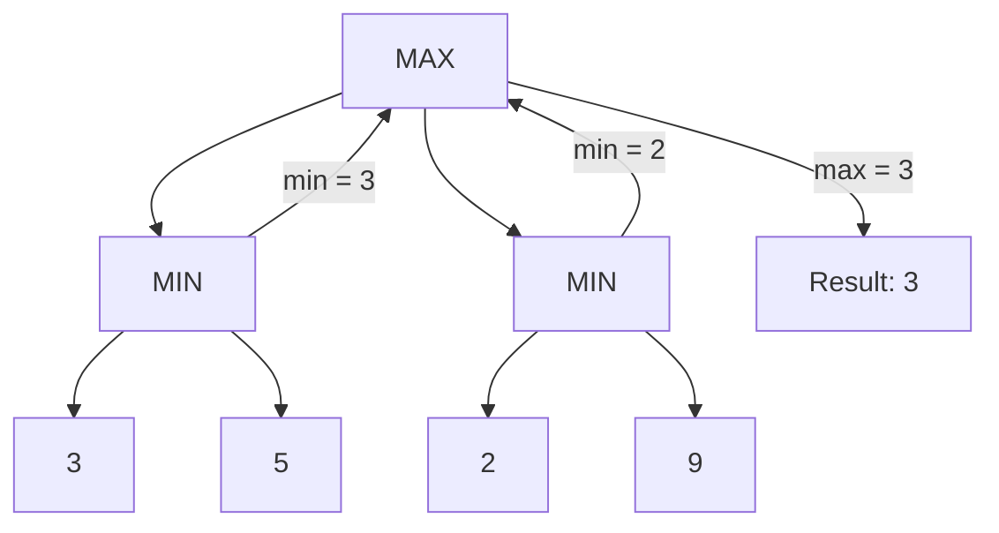

# AI — Search Strategies

> **Syllabus:** Search strategies (Informed, Uninformed, Adversarial).
> Revision sheet — focus on algorithms, properties, and GATE traps.

---

## TL;DR / Key Concepts

- **Uninformed (blind) search**: BFS, DFS, Depth-Limited, Iterative Deepening, Uniform-Cost.
- **Informed (heuristic) search**: Greedy Best-First, A*.
- **Adversarial search**: Minimax, Alpha-Beta pruning (game playing).
- **Key ideas**: completeness, optimality, time/space complexity, admissible heuristics.

```mermaid
flowchart TD
    A[Search Strategies] --> B[Uninformed<br/>no heuristic]
    A --> C[Informed<br/>with heuristic h(n)]
    A --> D[Adversarial<br/>game playing]
    B --> B1[BFS]
    B --> B2[DFS]
    B --> B3[Uniform-Cost]
    B --> B4[Iterative Deepening]
    C --> C1[Greedy Best-First]
    C --> C2[A*]
    D --> D1[Minimax]
    D --> D2[Alpha-Beta Pruning]
```

### Minimax Game Tree


### Search Algorithm Comparison
| Algorithm | Complete? | Optimal? | Data Structure |
|-----------|-----------|----------|----------------|
| **BFS** | ✅ | ✅ (unit cost) | Queue |
| **DFS** | ❌ | ❌ | Stack |
| **Uniform-Cost** | ✅ | ✅ | Priority queue |
| **Iterative Deepening** | ✅ | ✅ | Stack (repeated) |
| **Greedy Best-First** | ❌ | ❌ | Priority queue (h) |
| **A\*** | ✅ | ✅ (admissible h) | Priority queue (f) |

---

## 🎭 Story / Intuition

**The maze-navigation story (uninformed vs informed search).** Imagine a robot in a maze trying to find the exit.
- **BFS** explores the maze **level by level** — like checking every room at distance 1, then distance 2, etc. It's thorough (finds the shortest path) but explores a lot.
- **DFS** dives **deep down one path** until it hits a dead end, then backtracks — like a person who commits to one corridor and follows it to the end. It's fast if the exit is deep, but can waste time going down wrong paths.
- **A\*** is the **smart navigator** — it uses a *heuristic* $h(n)$ (like "as the crow flies" distance to the exit) to prioritize promising paths. It combines the cost so far $g(n)$ with the estimated remaining cost $h(n)$: $f(n) = g(n) + h(n)$. It's like a GPS that always heads toward the exit while accounting for distance already traveled.

**The "as the crow flies" story (heuristics & admissibility).** A **heuristic** is a *guess* about how close you are to the goal. For A* to be optimal, the heuristic must be **admissible** — it must *never overestimate* the true cost. Think of it as "as the crow flies" distance: the straight-line distance to a destination is always ≤ the actual road distance, so it's a safe (admissible) guess. If your heuristic *overestimated* (said "you're 1 km away" when you're really 10 km), A* might wrongly discard the optimal path.

**The chess-game story (adversarial search).** In a **two-player game**, you and your opponent take turns. **Minimax** assumes your opponent plays *optimally*: on your turns you pick the move that **maximizes** your score (MAX), and on their turns they pick the move that **minimizes** it (MIN). You evaluate the game tree by alternating max and min. **Alpha-beta pruning** is the trick that makes this practical: if you already know a branch can't beat your current best option, you **stop exploring it** (prune it). It's like a chess player who realizes "this line is clearly losing, no need to analyze it further" — same result as minimax, but far less computation.

---

## 📐 Key Formulas / Properties

### Uninformed Search
| Algorithm | Complete? | Optimal? | Time | Space |
|-----------|-----------|----------|------|-------|
| BFS | ✅ | ✅ (unit cost) | $O(b^d)$ | $O(b^d)$ |
| DFS | ❌ (infinite) | ❌ | $O(b^m)$ | $O(bm)$ |
| Uniform-Cost | ✅ | ✅ | $O(b^{1+\lfloor C^*/\epsilon\rfloor})$ | same |
| Iterative Deepening | ✅ | ✅ | $O(b^d)$ | $O(bd)$ |

($b$ = branching factor, $d$ = depth of solution, $m$ = max depth)

### Informed Search
- **Greedy Best-First**: expands node with smallest $h(n)$ (heuristic). Fast but **not optimal**.
- **A\***: expands node minimizing $f(n) = g(n) + h(n)$ where $g$ = cost so far, $h$ = heuristic.
- **A\* is optimal & complete** if $h(n)$ is **admissible** (never overestimates) and consistent.

### Adversarial Search (Minimax)
- Minimax value: $V(s) = \max_{\text{MAX}} \min_{\text{MIN}} \dots$ (alternating).
- **Alpha-Beta pruning**: prunes branches that cannot affect the result; same result as minimax, less computation.
- Best case alpha-beta: $O(b^{d/2})$ vs minimax $O(b^d)$.

---

## ✍️ Worked Examples

**Example 1 (BFS vs DFS):** BFS uses a **queue**; DFS uses a **stack**. BFS finds the shallowest goal; DFS may go deep.

**Example 2 (A\*):** If $g(n) = 3$ and $h(n) = 4$, then $f(n) = 7$. A* expands the node with the **smallest** $f$.

**Example 3 (Admissible heuristic):** For the 8-puzzle, the Manhattan distance heuristic is:
- **Answer:** admissible (never overestimates the true cost).

**Example 4 (Minimax):** In a game tree, MAX chooses the child with the **maximum** minimax value; MIN chooses the **minimum**.

---

## 🎯 GATE PYQs

**Q1 (GATE DA 2024, 2 marks):** Breadth-First Search is guaranteed to find the shallowest goal when:
- **Answer:** all edge costs are equal (unit cost).

**Q2 (GATE DA 2024, 2 marks):** A* search is optimal if the heuristic is:
- **Answer:** admissible (and consistent).

**Q3 (GATE DA 2025, 2 marks):** The data structure used by BFS is:
- **Answer:** queue.

**Q4 (GATE DA 2025, 2 marks):** Alpha-Beta pruning:
- (A) changes the result of minimax (B) prunes branches without changing the result (C) is only for single-player (D) none
- **Answer: (B)** — prunes branches that cannot affect the minimax value.

**Q5 (GATE DA 2026, 2 marks):** Greedy best-first search is:
- **Answer:** not guaranteed to be optimal.

---

## 📚 Deep Dive

- [AI Search — Deep Dive](../_deep_dives/ai_search_deep.md) — heuristic design, A* proof, game trees, more PYQs.

---

## 🔗 Prerequisites / Cross-References

- Requires [Data Structures](../04_Programming_Data_Structures/data_structures.md) (graphs, queues, stacks) and [Algorithms](../04_Programming_Data_Structures/algorithms.md) (BFS/DFS).
- See [AI Logic](ai_logic.md) for the knowledge-representation counterpart.