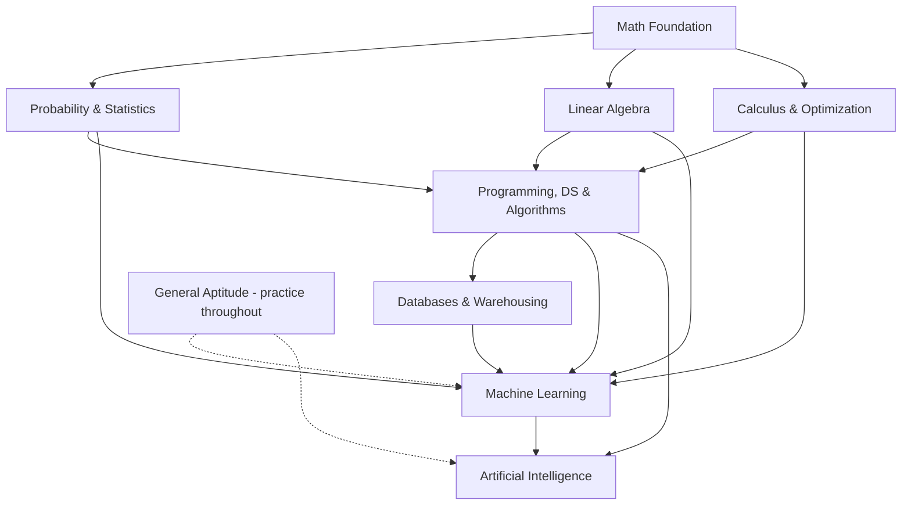

# GATE DA — Study Notes

> **Data Science and Artificial Intelligence (DA)** — GATE paper evaluates mathematical foundations, machine learning frameworks, and statistical requirements of modern data analytics.

This is a **revision-focused** notes system for candidates who have already completed their degree. Each topic is a **short `topic.md`** (key concepts, formulas, worked examples, and real GATE PYQs) with a link to a **deep-dive file** for in-depth study.

> **Note on shared topics:** Several DA topics overlap with the [GATE CS](../GATE_CS/README.md) notes (Probability, Linear Algebra, Calculus, Data Structures, Algorithms, Databases). To avoid duplication, those `topic.md` files **cross-reference** the GATE_CS notes for foundational content and only add DA-specific material. Follow the links when you need the full treatment.

---

## 📊 Exam Structure

| Section | Marks |
|---------|-------|
| **General Aptitude** (Verbal, Quantitative, Spatial, Logical) | 15 |
| **Core Subject Syllabus** | 85 |
| **Total** | 100 |

---

## 🗺️ Syllabus Map & Navigation

### 00 — General Aptitude (15 Marks)
- [General Aptitude](00_General_Aptitude/aptitude.md) — Verbal, Quantitative, Spatial, Logical Reasoning

### 01 — Probability and Statistics
- [Probability](01_Probability_Statistics/probability.md) — Counting, conditional probability, Bayes, random variables, distributions, expectation, variance, conditional expectation
- [Statistics](01_Probability_Statistics/statistics.md) — Mean/median/mode, std. deviation, correlation, covariance, regression, sampling, CLT, hypothesis testing

### 02 — Linear Algebra
- [Linear Algebra](02_Linear_Algebra/linear_algebra.md) — Vector spaces, subspaces, linear dependence/independence, matrices, systems of equations, eigenvalues/vectors, SVD, LU

### 03 — Calculus and Optimization
- [Calculus](03_Calculus_Optimization/calculus.md) — Functions, limits, continuity, derivatives, maxima/minima, partial derivatives
- [Optimization](03_Calculus_Optimization/optimization.md) — Unconstrained optimization, gradient descent

### 04 — Programming, Data Structures and Algorithms
- [Python](04_Programming_Data_Structures/python.md) — Python programming essentials
- [Data Structures](04_Programming_Data_Structures/data_structures.md) — Stacks, Queues, Linked Lists, Trees, Graphs
- [Algorithms](04_Programming_Data_Structures/algorithms.md) — Search, sort, time/space complexity, basic graph algorithms

### 05 — Database Management and Warehousing
- [Databases](05_Databases_Warehousing/databases.md) — ER-modeling, relational model, SQL, normalization
- [Data Warehousing](05_Databases_Warehousing/data_warehousing.md) — Star schema, snowflake schema

### 06 — Machine Learning
- [Supervised Learning](06_Machine_Learning/supervised_learning.md) — Linear/Logistic Regression, SVM, Decision Trees, Naive Bayes, Random Forests, K-NN, Neural Networks
- [Unsupervised Learning](06_Machine_Learning/unsupervised_learning.md) — K-Means, Hierarchical Clustering, PCA
- [Model Evaluation](06_Machine_Learning/model_evaluation.md) — Bias-variance tradeoff, cross-validation, evaluation metrics

### 07 — Artificial Intelligence
- [Search Strategies](07_Artificial_Intelligence/ai_search.md) — Informed, Uninformed, Adversarial search
- [Logic](07_Artificial_Intelligence/ai_logic.md) — Propositional and First-order logic

---

## 📚 Deep-Dive References

Detailed in-depth files for DA-specific topics live in [`_deep_dives/`](_deep_dives/). Each `topic.md` links to its corresponding deep-dive file for full derivations, extended examples, and textbook/NPTEL references. Shared topics link to the existing [GATE_CS deep dives](../GATE_CS/_deep_dives/).

---

## 🧭 Recommended Study Order

1. **Probability & Statistics** → **Linear Algebra** → **Calculus & Optimization** (mathematical foundation)
2. **Programming, Data Structures & Algorithms** (Python + DS/Algo)
3. **Databases & Warehousing**
4. **Machine Learning** (builds on math + statistics + optimization)
5. **Artificial Intelligence** (search + logic)
6. **General Aptitude** (practice throughout)

---

## 📖 How to Use These Notes

1. **Short notes first** — Read the `topic.md` TL;DR and key concepts to refresh.
2. **Formulas** — Memorize the KaTeX formula blocks.
3. **Worked examples** — Understand the solved problems.
4. **GATE PYQs** — Attempt the 3-5 real previous-year questions per topic, then check answers.
5. **Go deep** — Follow the deep-dive link when you need full derivations or more examples.
6. **Cross-reference** — Follow prerequisite links to related topics (including GATE_CS notes for shared foundations).

---

## 🔗 Cross-Reference Map (Prerequisites)

| Topic | Depends On |
|-------|-----------|
| Statistics | Probability, Calculus |
| Optimization | Calculus (partial derivatives), Linear Algebra |
| Linear Algebra | (foundation) |
| Algorithms | Data Structures |
| Machine Learning | Probability & Statistics, Linear Algebra, Optimization, Python |
| Model Evaluation | Machine Learning (supervised/unsupervised) |
| Artificial Intelligence | Discrete Math (logic), Data Structures (graphs) |
| Data Warehousing | Databases |
| Databases | Discrete Math (Sets/Relations) |

### Shared topics → GATE_CS references
| DA Topic | GATE_CS Reference |
|----------|-------------------|
| Probability | [GATE_CS Probability](../GATE_CS/01_Engineering_Math/probability.md) |
| Linear Algebra | [GATE_CS Linear Algebra](../GATE_CS/01_Engineering_Math/linear_algebra.md) |
| Calculus | [GATE_CS Calculus](../GATE_CS/01_Engineering_Math/calculus.md) |
| Data Structures | [GATE_CS Data Structures](../GATE_CS/04_Programming_Data_Structures/data_structures.md) |
| Algorithms | [GATE_CS Algorithms](../GATE_CS/05_Algorithms/algorithms.md) |
| Databases | [GATE_CS Databases](../GATE_CS/09_Databases/databases.md) |